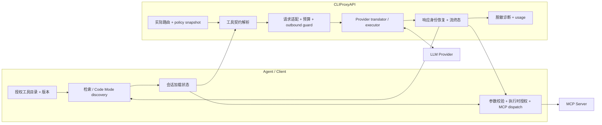
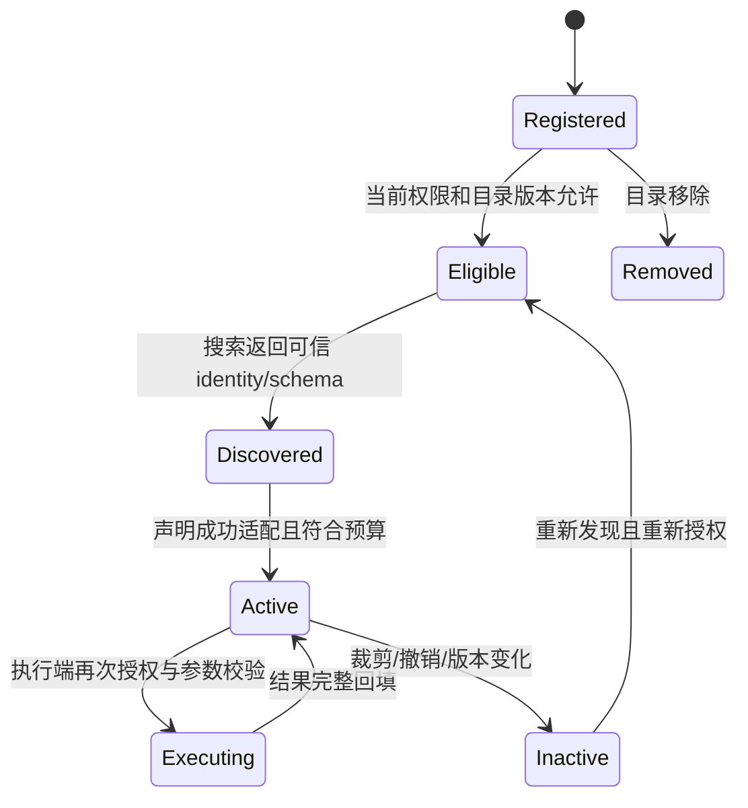
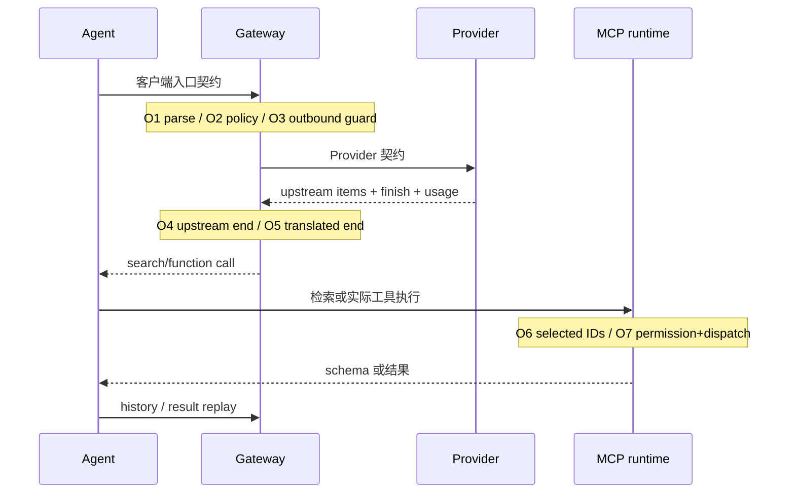

# 跨 Provider 工具按需加载完整方案 / Implementation Plan

> **For agentic workers:** 实施时使用已安装的 `executing-plans` 技能逐项执行；需要委派时只使用 `luna_worker`，每个文件只有一个写入者。下列步骤采用 `- [ ]` 跟踪。本次只授权研究和文档交付，步骤尚未执行。

**Goal:** 使具有大量工具的 Coding Agent，经 CLIProxyAPI 接入已声明支持的 LLM Provider 时，能够可靠地发现、按需加载并执行工具，在明确语义边界内降低上下文占用，并用可复现证据验证任务质量、成本与延迟。

**Architecture:** 客户端拥有目录、检索、权限和工具执行；CLIProxyAPI 沿现有 `internal/responsestools` 管线完成路由能力判断、协议转换、身份恢复、预算和终态检查。原生发现、普通函数桥接与客户端 Code Mode 分别认证；有损转换必须记录语义差异，不用一个布尔值表示全部兼容性。

**Tech Stack:** Go 1.26.4、现有 CLIProxyAPI SDK/translator、Codex 0.160.0、OpenCode 1.18.32、MCP、Responses/Chat/SSE；验收工具使用 Python 标准库及可移植 CLI。客户端升级属于单独事项，不作为本方案默认前提。

**Spec:** 本文件第 3–10 节是设计规格，第 11–15 节是实施与验收方案；执行者同时阅读 [当前协议文档](../../responses-tools.md) 和 [2026-10-12 验收报告](../../acceptance/2026-10-12-tool-loading.md)。

**状态：** Proposed，等待技术评审；不是已经实施的功能清单。

**核验日期：** 2026-10-12（Asia/Shanghai）。源码基线 `d83bb9be345d3e283fa52e787962790a0afab3c1`，修复入口 [PR #25](https://github.com/hrygo/CLIProxyAPI/pull/25)。PR 的 CI 已在本次研究前通过，尚未合并或部署；后续状态以 GitHub 实测为准。

**2026-10-13 执行范围更新：** 用户已授权按本方案实施，客户端范围扩展为 Codex、OpenCode、Claude Code 与 MCP。上面的 Proposed、只授权研究及下文“本次研究只写本文件”描述原始研究阶段，不能覆盖后续实施授权；五项验收门槛及不发布、不切默认配置、不重启原服务的约束继续有效。Claude Code 的新增独立证据范围见 [范围增补](../../acceptance/2026-10-13-claude-code-scope_CN.md)。旧批次不迁移认证；最终矩阵须覆盖新增客户端，60-case 是原门槛，必要时增加案例以覆盖已声明范围，不能通过删除既定路由来凑数。

**2026-10-13 客户端优先级调整：** 用户明确 OpenCode 本身支持配置不同 Provider，不应作为 CLIProxyAPI 的重点使用场景。后续实施与专项排障优先完成 **Codex / Claude Code → CLIProxyAPI → 不同 Provider**，验证网关的协议适配、工具声明/激活、身份与终态，以及客户端执行闭环。OpenCode 保留已有案例、失败记录及必要对照，不再优先扩展其客户端专项修复。此调整改变投入顺序，不撤销既定证据范围，不降低五项验收门槛；未解决的 OpenCode 能力继续单列为有限实测或未知，不能删除失败来提高通过率。

## Global Constraints

- 不发布、不安装候选、不改默认配置或 catalog、不重启原服务；未来部署须另行授权。
- `main` 为自有 fork 主干，任务分支使用 `codex/*`；本方案不在只读归档分支上开发。
- 保留模块路径 `github.com/router-for-me/CLIProxyAPI/v8`，沿既有 canonical policy → provider translation 架构演进。
- `requests.responses-tools` 保持唯一行为策略来源；能力报告和验收证书是证据，不能成为第二套隐式策略配置。
- 正常适配不引入网络请求、不执行 MCP、不自动选择其他模型、不复制或持久化凭据。
- 工具执行授权由客户端在执行时核验，发现/加载不授予执行权限。
- 不透明历史、身份冲突、非法声明与真实断流按已有契约明确失败，不丢弃历史、不猜身份、不伪造完成。
- 不给已建立的上游连接新增网络超时；客户端验收进程可有明确的任务预算，测试终止不修改服务网络语义。
- Go 验证固定 `GOTOOLCHAIN=go1.26.4`；格式使用该工具链的 `gofmt`；只格式化改动文件。
- 原始证据默认本地、Git 忽略；公开报告只包含脱敏聚合、fixture 和确定性回归，无凭据、真实业务内容或访问地址。
- 本文命令使用原生工具，实施环境按本机约定进行 RTK 路由；不把本机 wrapper/缓存路径写进可复用脚本。
- 本次研究只写本文件，不更新 PR、源代码、默认配置、长期记忆或运行态。

## Review Focus

1. 历史中间出现 `additional_tools`：提升声明会改变位置语义，不能用 ID 保留证明位置等价；对应任务 T1。
2. 第二轮发现 B 后再次调用 A：预算裁剪与原生累积契约可能不同，须说明 active set 并验证身份；对应任务 T2。
3. Code Mode 的 `execute` 获准、底层 MCP 工具被拒：必须在实际 dispatch 阻止调用，不能由入口许可覆盖；对应任务 T5。
4. 流已输出工具调用后断开或重试换路由：不能重复执行工具、伪造完成或复用旧别名状态；对应任务 T4。
5. schema/grammar 降级与缓存 usage 缺失：分别标记语义损失和未知指标，不能以“可调用”“0 tokens”替代；对应任务 T1/T6。

---

## 1. 结论与建议决策

本问题尚未完备解决。PR #25 解决了已观察到的 GPT Lite 搜索格式、Muse 工具激活与 Lite 声明兼容，以及明确结束的 reasoning-only 响应漏终态。现有证据支持“指定客户端版本、模型路由与短任务可形成闭环”，不能外推为任意 Agent、任意 Provider、任意长会话都可靠且省钱。

推荐采用 **客户端主导发现 + Gateway 保持协议语义 + 按路由认证** 的主路线，继续复用已有实现。Codex 原生客户端检索和 OpenCode Code Mode 是两种客户端策略，分别验证，不强行改成同一种内部协议。Provider 的原生搜索作为可选择的优化；普通函数调用桥接是跨 Provider 的基础。

先完成现有修复的语义审查、生命周期测试和最终版本复测，再增加能力证据与脱敏诊断。Gateway 自行维护目录和搜索循环仅作为不支持发现的 Agent 的后续可选适配项目，需要独立设计，不纳入当前核心的默认职责。

“完备”定义为：**支持范围有限且清楚、范围内行为符合契约、降级可辨识、失败可定位、任务质量达到门槛、收益有代表性证据、部署后可验证与回退。** 不要求数学意义上支持所有 LLM 或所有工具，也不以单次成功代替认证。

## 2. 证据基线与可信度

> 🧠 **From Hindsight memory (协议与配置验收入口)** — 沿用统一 `internal/responsestools` 管线、调用身份/声明预算约束及终态验收；HTTP 200 与工程门禁不能替代真实客户端闭环。历史约定已与当前代码核对，历史成功记录不作为本次在线状态证明。

### 2.1 证据等级

| 标记 | 含义 | 可支持的结论 |
| --- | --- | --- |
| E1：当前源码 | 指定 commit 的实现和确定性测试 | 转换规则、拒绝条件、边界与代码位置 |
| E2：隔离实测 | 真实客户端 → 候选 Gateway → Provider → 实际 MCP | 被测试版本/路由/用例的闭环与 usage |
| E3：官方契约 | 核验日读取的 Provider/Agent/MCP 文档或指定版本源码 | 预期语义及官方接口，不等于本机启用 |
| E4：历史 | 项目知识页、旧设计和旧报告 | 决策依据与演进背景 |
| P：方案 | 本文件的类型、文件、指标门槛与工期建议 | 待评审设计，不能标记为已经支持 |

本次不重新执行 live Provider 验收；E2 沿用当天证据，源码基线未变化，当前可用性未重新确认。主代理已用 `check_index_coverage` 复核所依赖的 19 个源码/测试文件：图谱 generation 为 `2026-10-01T23:35:31Z`，部分文件 metadata 已变化，`additional_tools.go` 等新文件尚未被该 generation 跟踪；相应结论以当前定向源码补核，不声称已完成全仓结构审计，也未重建索引。2026-09-26 的旧插件设计属于历史，当前主路线已是核心管线，不重新启用旧 shim。

### 2.2 当前实测

| 集合 | 结果 | 限度 |
| --- | ---: | --- |
| 前一修复轮正式案例 | 26/29 | 包含 GLM 断流、Gemini 检索失败、Muse Lite 拒绝 |
| 后续首轮 eager/lazy 矩阵 | 19/20 | eager 10/10，lazy 9/10，Muse description 失败 |
| 最终 Muse Lite Search 重复 | 3/3 | 每轮 3 请求；一例 108.57 秒 |
| Codex Gemini 复测 | 3/3 | 5/4/4 请求，JSON-only 均未达标 |
| OpenCode Gemini Code Mode fixture | 2/2 | 真实 MCP 另计 |
| GLM Codex Search | 4/4 | 没有重现旧失败，不证明旧失败原因已确定 |
| 真实 codebase MCP | 2/2 | 实际执行 `index_status`，返回 `graph_status=ready` |
| 有通过证据的组合 | 20/20 | 是组合覆盖，不是最终版本单次完整矩阵 |
| 后续全部研发/验收尝试 | 核心成功 32/39 | 跨候选和可用性失败，不作为最终版本可靠性分母 |

合并修复增加 19 个测试函数及表驱动场景；Go 1.26.4 本地门禁为 100 个通过 package、13,715 个通过测试/子测试，相关 race、vet、build、格式、28 个维护测试及离线目录验证通过。CI 通过与 E2 是不同证据；CI 不接触真实 Provider。

### 2.3 首轮与全任务输入

使用 Provider 实际 input usage，包含缓存输入；模型之间不比较 tokenizer，也不直接解释为账单节省。

| 客户端 / 模型路由 | 首轮 eager → lazy | 首轮减少 | 全任务 eager → lazy | 全任务减少 |
| --- | ---: | ---: | ---: | ---: |
| Codex / `gpt-6-luna` | 55,451 → 19,465 | 64.90% | 110,986 → 68,298 | 38.46% |
| Codex / `qwen-ds41-flash` | 61,655 → 20,502 | 66.75% | 123,515 → 75,069 | 39.22% |
| Codex / `opencode-go-glm53-flash` | 61,007 → 19,915 | 67.36% | 122,106 → 75,915 | 37.83% |
| Codex / `gemini-3.5-flash-lite` | 62,283 → 19,360 | 68.92% | 124,932 → 100,061 | 19.91% |
| Codex / `opencode-go-muse-spark-1.3` | 61,010 → 20,730 | 66.02% | 122,156 → 85,594 | 29.93% |
| OpenCode / `gpt-6-luna` | 36,714 → 7,137 | 80.56% | 73,505 → 35,754 | 51.36% |
| OpenCode / `qwen-ds41-flash` | 47,833 → 8,429 | 82.38% | 95,837 → 39,841 | 58.43% |
| OpenCode / `opencode-go-glm53-flash` | 46,658 → 8,082 | 82.68% | 93,375 → 72,807 | 22.03% |
| OpenCode / `gemini-3.5-flash-lite` | 50,462 → 10,009 | 80.17% | 101,009 → 45,228 | 55.22% |
| OpenCode / `opencode-go-muse-spark-1.3` | 46,456 → 8,450 | 81.81% | 93,044 → 39,545 | 57.50% |

Gemini 三个成功 Search 案例总输入为 145,039 / 100,061 / 109,319，相对 eager 124,932 分别增加 16.09%、减少 19.91%、减少 12.50%。这个反例必须保留：协议正确与首轮节省不能保证全任务收益。

这 10 对数据的逐路由全任务降幅中位数为 **38.84%**，范围 **19.91%–58.43%**，仅为描述性摘要；eager 20 个请求、lazy 33 个请求，请求数增加 **65%**。不同模型 tokenizer 与价格不同，不能把 raw tokens 相加后当作统一上下文或账单收益。其原始输入计数分别为 1,060,465 与 638,112，仅用于该混合集合的工作量投影。表格使用矩阵成功案例及修复后的 Muse Lite 配对，没有把研发失败/补测成本全部纳入，所以不是 intent-to-treat 全体验收收益；最终修复后的单一 revision 尚需完整重跑。

## 3. 问题定义、目标与非目标

### 3.1 四种容易混淆的“按需”

| 层次 | 优化对象 | 例子 | 当前结论 |
| --- | --- | --- | --- |
| 注册/连接 | 是否启动 MCP、拉目录和建立连接 | 首次使用时初始化 server | 与 schema 延迟注入独立，本轮未认证 |
| 传输 | HTTP body 是否携带完整目录 | 客户端只返回已检索 schema | Codex fixture 首轮已证明不含 64 个工具名称 |
| 模型上下文 | Provider 是否将完整定义放入模型输入 | 原生 `defer_loading` | 原生与桥接分别认证；不能只看 HTTP body |
| 执行/结果 | 执行多少工具、返回多少结果正文 | Code Mode 内部汇总结果 | 依赖客户端 runtime，本轮只有受限任务证据 |

Claude 官方原生 deferred search 仍要求每次请求发送完整定义，由服务端控制模型加载；MCP `tools/list` 的目录发现也不规定模型何时注入 schema。因此，不能把“请求仍含 schema”直接判成未生效，也不能把“工具已注册”判成已经全量进入模型。[Claude Tool search](https://platform.claude.com/docs/en/agents-and-tools/tool-use/tool-search-tool)、[MCP Tools 2025-11-25](https://modelcontextprotocol.io/specification/2025-11-25/server/tools)

### 3.2 需求编号

| ID | 必须满足的要求 | 主责任 |
| --- | --- | --- |
| R1 | 首轮仅包含必要入口/常用工具与有预算的目录摘要 | Agent |
| R2 | 有效工具可发现，空结果和歧义可恢复且有轮数预算 | Agent/模型 |
| R3 | 已加载工具可调用，身份、参数、结果及终态完整 | Gateway/Agent |
| R4 | 原始 schema、grammar、位置/历史语义有明确保真等级 | Gateway/执行端 |
| R5 | 权限过滤与执行时再次授权，Code Mode 不旁路底层权限 | Agent/工具服务 |
| R6 | 多轮、恢复、撤销、版本变更与路由切换可预测 | Agent/Gateway |
| R7 | 对外能力公告对应实际候选路由和实测证据 | Gateway |
| R8 | 目录、声明和尝试状态受预算约束并正确释放 | Agent/Gateway |
| R9 | 有脱敏、可关联的失败诊断和请求级计量 | Gateway/QA |
| R10 | 成功率不劣化，峰值上下文与任务收益分别有证据 | QA/产品 |
| R11 | 可复现、可持续回归，并明确版本/支持范围 | QA/维护者 |
| R12 | 部署、默认切换与回退独立验收，不以 PR 状态代替运行状态 | 维护者/运维 |

### 3.3 非目标

- 任意不能调用函数的模型，都能靠 Gateway 自动完成工具发现。
- 通过一个 `supports_search_tool=true` 开关，让不支持动态目录的所有 Agent 获得完整生命周期。
- 在 Gateway 自动执行客户端工具、放宽执行权限或接管本机 MCP 登录。
- 删除已注册工具、禁用连接器以制造节省；优化模型可见定义，不裁剪用户工具目录。
- 保证所有任务必然节省成本，或把输出格式、模型推理质量全部归为工具协议问题。
- 在当前阶段建立跨租户持久化目录服务、跨会话工具内容数据库或通用代码执行平台。

### 3.4 上下文预算的其余组成

工具 schema 优化只处理一部分输入：system/developer 指令、AGENTS.md、技能目录、常驻工具、代码阅读、结果正文和历史也会占用上下文。既有线包中 Codex 仍发送 21/22 个常驻声明；OpenCode 把 fixture 的 64 个 MCP 声明变为一个 `execute`，其摘要并非零开销。auxiliary `o200k_base` 的 schema JSON 估计约减少 89%/93.49%，仍不能代替 Provider 的完整 input usage。[测量来源](../../acceptance/2026-10-12-tool-loading.md)

本轮客户端证据来自 CLI runner，不能直接当作 Codex Desktop 所有内置工具、连接器和指令的注入审计。将 Desktop 纳入后续支持范围时，独立记录 app/runtime 版本、常驻/可发现工具、实际请求与可观测 usage；看不到模型侧序列化时标未知。优化 tool schema 不授权清理全局指令、删注册项或调整用户插件。

验收分解 client wire 的常驻声明、deferred 声明、摘要、history 和结果字节；tokenizer 估计注明版本。Provider 未披露组件级 tokens 时，保留总 input 和成对差异，不反推出一个伪精确的“schema 实际 token”数。

## 4. 官方契约与客户端版本边界

### 4.1 Provider 原生支持不是唯一途径

OpenAI Responses 区分 hosted search 与 client-executed search。后者由应用返回同 `call_id` 的搜索结果；`additional_tools` 还有输入位置语义。普通函数调用是跨 Provider 的 backend primitive：Gateway 还必须双向映射搜索请求/结果、选中声明、后续调用及身份/终态，客户端必须能安装并执行结果，模型也须正确使用入口。供应商标称 function calling 本身不能证明 Codex deferred search 已受支持；映射保真等级逐 route 认证。[OpenAI Tool search](https://developers.openai.com/api/docs/guides/tools-tool-search)

Provider 的原生支持、模型任务能力、Agent 的运行时能力和 Gateway 的适配能力是四个独立条件。某模型能调用一个预算函数，并不证明它能稳定生成适合 BM25 的查询；某 API 接受 Responses，也不证明它接受 Lite、namespace、custom grammar 或完整历史。

### 4.2 Codex 0.160.0：有效能力判定与客户端检索

本轮版本为 Codex 0.160.0 与 OpenCode 1.18.32。Codex 通过临时 catalog/CLI overrides 启用搜索，OpenCode fixture 使用 `OPENCODE_EXPERIMENTAL_CODE_MODE`。这些事实来自实际 runner；不是默认配置已经改变的证明。

指定 tag `rust-v0.160.0` 源码显示，搜索成立需要模型 `supports_search_tool` 为真且 provider 允许 `namespace_tools`；缺失的模型字段默认为 false。旧的 `features.tool_search` 已成为兼容 no-op，不能把写入该键当成启用证据。MCP exposure 随有效能力在 deferred/direct 之间选择；runner 必须检查实际首轮线包。[模型字段](https://github.com/openai/codex/blob/rust-v0.160.0/codex-rs/protocol/src/openai_models.rs#L449-L455)、[有效能力 gate](https://github.com/openai/codex/blob/rust-v0.160.0/codex-rs/core/src/tools/spec_plan.rs#L623-L635)、[旧 flag](https://github.com/openai/codex/blob/rust-v0.160.0/codex-rs/features/src/lib.rs#L227-L230)、[MCP exposure](https://github.com/openai/codex/blob/rust-v0.160.0/codex-rs/core/src/mcp_tool_exposure.rs#L73-L83)

检索由客户端 BM25 索引完成，索引包含工具名、title、description、server/connector 信息与部分参数字段，使用 English tokenizer。中文、缩写、否定描述与相似干扰工具需要独立检索语料，不能仅验证模型是否发出一次搜索。Gateway 看不到完整客户端索引，因此无法单独修复排名问题。[检索实现](https://github.com/openai/codex/blob/rust-v0.160.0/codex-rs/core/src/tools/handlers/tool_search.rs#L130-L249)、[索引文本构造](https://github.com/openai/codex/blob/rust-v0.160.0/codex-rs/core/src/tools/handlers/mcp.rs#L511-L557)

Codex 同版本也存在 `ToolMode::{CodeMode, CodeModeOnly}`；`code_mode`/`code_mode_only` flags 属于 under development、默认关闭，但模型 `tool_mode` 可优先指定模式，实际模式还涉及 runtime availability/fallback。不能仅凭 flag 关闭推断有效模式为 Direct。它是**源码已存在但本轮未独立认证的条件能力**，不能当作功能缺失，也不能直接套用 OpenCode 验收。adapter 记录有效模式与 feature 状态；当前主矩阵锁定已实测的 Codex search wire contract，Codex Code Mode 及其与 search 的组合可作为后续独立实验。[模型模式](https://github.com/openai/codex/blob/rust-v0.160.0/codex-rs/protocol/src/openai_models.rs#L323-L327)、[feature 状态](https://github.com/openai/codex/blob/rust-v0.160.0/codex-rs/features/src/lib.rs#L1029-L1070)、[模式与 fallback](https://github.com/openai/codex/blob/rust-v0.160.0/codex-rs/core/src/tools/mod.rs#L68-L88)

### 4.3 OpenCode 1.18.32：Code Mode 与底层执行

指定 tag `v1.18.32` 的实验 flag 默认关闭；启用 Code Mode 时注册 `execute`，常规 MCP 工具不再逐个加入模型工具列表。目录仍会在客户端获取和缓存；Code Mode 的摘要与本地 discovery 替代全量 schema 注入，不能称为 MCP server 全部按需连接。[flag](https://github.com/anomalyco/opencode/blob/v1.18.32/packages/opencode/src/effect/runtime-flags.ts#L8-L46)、[模型工具集合](https://github.com/anomalyco/opencode/blob/v1.18.32/packages/opencode/src/session/tools.ts#L374-L394)、[目录策略](https://github.com/anomalyco/opencode/blob/v1.18.32/packages/codemode/README.md#L159-L207)

底层 permission 检查已经存在：每次执行构造可见目录，实际调用还检查 MCP tool 权限。当前 adapter 创建 runtime 未传入显式 `limits`，library 默认不设工具次数/执行时长限制。OpenCode 已有用户取消、单 MCP 调用 timeout 和结果呈现，但这些不等于 Code Mode 累计调用数、纯计算或结果大小上限；最终结果序列化也不能当作自动截断。验收的“最多 7 个 Provider 请求”约束不了一个 `execute` 内的多次 MCP dispatch。[现有权限/取消路径](https://github.com/anomalyco/opencode/blob/v1.18.32/packages/opencode/src/tool/code-mode.ts#L124-L285)、[runtime limits](https://github.com/anomalyco/opencode/blob/v1.18.32/packages/codemode/README.md#L235-L259)

原始 JSON Schema 校验不能算成已有防线：OpenCode 将 MCP schema 传给 CodeMode 用于呈现签名，而 JSON Schema 模式不校验传入值；dispatch 将参数交给 MCP。需客户端 validator 或工具服务在产生副作用前验证，独立证明该路径存在。[工具树与 dispatch](https://github.com/anomalyco/opencode/blob/v1.18.32/packages/opencode/src/tool/code-mode.ts#L111-L149)、[JSON Schema 的 render-only 语义](https://github.com/anomalyco/opencode/blob/v1.18.32/packages/codemode/README.md#L64-L75)

OpenCode V2 官方文档描述不同的 Code Mode 配置与默认行为，不能套用于 V1.18.32。方案先锁定现有版本及其真实线包，再单独评估升级；升级触发重新认证。[OpenCode V2 MCP](https://opencode.ai/v2/docs/mcp-servers)、[OpenCode V1 MCP](https://docs.opencode.ai/docs/mcp-servers/)

### 4.4 MCP 是目录与执行契约

MCP 的 `tools/list`、分页和 `notifications/tools/list_changed` 为目录更新提供基础；模型侧检索、延迟定义和 Code Mode 属于客户端/Provider 实现。客户端应先依据授权形成目录，再对该目录建立检索索引；变更通知导致目录版本更新和旧结果失效。实际采用的 MCP revision 按 server/client 协商记录，不把 draft 或最新官网当成本机已支持。[MCP Tools](https://modelcontextprotocol.io/specification/2025-11-25/server/tools)

## 5. 三种架构路线与选择依据

| 路线 | 目录/检索在何处 | Provider 最低条件 | 优点 | 代价及适用范围 |
| --- | --- | --- | --- | --- |
| A：Agent 原生 deferred discovery + Gateway 桥接 | Agent | 可表达普通函数调用，或支持原生搜索 | 复用现有目录、权限与 dispatch；Gateway 不保存跨请求目录 | 受客户端能力和检索质量制约；Codex 为当前主路线 |
| B：Agent Code Mode | Agent 的受控 runtime | 入口可经 Gateway 映射，模型能正确生成代码 | Provider 只见少数入口，工具批处理/结果汇总有潜在收益 | 依赖代码生成、沙箱、底层权限与调试；OpenCode 已有限实测，Codex 条件能力未认证 |
| C：Gateway virtual discovery | Gateway 协调目录、搜索与内部推理循环 | 普通函数调用，并能向原客户端返回合法工具调用 | 可覆盖部分只会 eager 的 Agent | 目录隔离、会话关联、预算、授权、取消与副作用处理显著增加；单独适配项目 |

推荐 A 与 B 并行认证，共享 Gateway 的协议规范化和证据体系。C 仅在识别出重要的 eager-only 客户端需求后立项，先确定其工具注册和授权 API 是否允许被代理协调。Gateway 不能仅凭裁剪 `tools` 实现 C：模型仍需发现入口、搜索结果、可调用声明和结果回填。

原生 Provider 搜索可作为 A 的一个 backend：候选目录已在请求中且允许发送服务端时使用 hosted；项目/租户状态动态且需要客户端权限控制时优先 client discovery。不能把原生 search 与普通桥接的 cache/position 语义混为一谈。

## 6. 推荐架构、状态与职责



Gateway 的行为配置继续在 `requests.responses-tools`。新增证据结构属于内部实现，先不新增公共端点或另一个模型策略文件。Codex catalog 的现有布尔能力仍可作为兼容投影；更细的信息先用于认证报告、测试和诊断。只有客户端需要自动消费时，再独立评审公开能力接口。

### 6.1 工具状态模型（建议）



`Registered` 不等于模型可见，`Discovered` 不等于已授权执行，`Active` 不保证模型会正确选择工具。状态模型由客户端持有；Gateway 只保留当前 attempt 所需的解析和恢复状态，继续利用显式历史重建，避免新增全局隐式会话数据库。

### 6.2 身份、版本和隔离

最小 identity 沿用现有 namespace/local name/kind；另记录原始 schema fingerprint、目录 generation、会话所绑定的权限 generation。schema hash 用规范化原始声明计算，不把 provider 改写后的 schema 当成原定义；长度受限的 flat alias 只存在于 attempt，不作为永久工具 ID。

目录和索引按项目/租户/授权主体隔离。session ID 只用于关联，不能作为授权凭据。动态目录变更先使旧检索结果失效，再允许新调用；已产生的历史调用/结果身份继续可回放，不能因为工具撤销而删除过去事实。

### 6.3 路由和重试

一次 attempt 固定 actual route 和 policy snapshot；重试从原始客户端请求新建 attempt，不复用失败路由的 alias、lease 或流序列。显式历史可跨 Provider 重译；只有远端 `previous_response_id` 的状态不能自动迁移。

认证区分“响应尚未向客户端暴露时的 retry”与“客户端已看到工具调用后的 retry”。后者必须由现有执行层和客户端明确处理取消/重放；Gateway 不添加自动工具重执行。side-effect 夹具只运行在假的 sandbox 工具中，以 dispatch 日志和唯一操作 ID 检验重复调用。

## 7. Gateway 能力模型与语义保真

### 7.1 已具备能力与新增目标

| 能力 | 当前基础 | 本方案补齐 |
| --- | --- | --- |
| 实际路由匹配 | 精确 provider/auth/model/format/endpoint；convention + override | 记录认证 scope，不按客户端 alias 推断支持 |
| discovery bridge | native/bridge；调用身份恢复；只激活发现工具 | 位置与跨轮语义专项审查 |
| 能力公告 | `ClientSearchSupported` 聚合可选路由，disabled route 可否决 | 将可表达策略与实测认证分开，细分维度 |
| schema/custom | required/nullable、refs、custom function/grammar describe | 生成 TransformationReport，明确有损项 |
| 历史与流 | 显式历史重译、身份校验、预算、SSE 完整性 | cancellation、retry、WS 与长历史认证 |
| 计量和诊断 | 现有 usage 与固定错误原因 | 统一脱敏观察点、协议链断点和证据关联 |

### 7.2 内部 CapabilityProfile（建议结构，尚未实现）

```json
{
  "profile_version": 1,
  "scope": {
    "client": "codex",
    "client_version": "0.160.0",
    "gateway_revision": "d83bb9be345d3e283fa52e787962790a0afab3c1",
    "provider": "meta",
    "auth_kind": "api-key",
    "upstream_model": "opencode-go-muse-spark-1.3",
    "upstream_format": "codex",
    "endpoint_scope_id": "endpoint-fixture-a"
  },
  "discovery": "native-portable",
  "request_dialects": ["responses", "responses-lite-lifted"],
  "transports": ["http-buffered", "sse"],
  "history": "explicit-replay",
  "tool_position": "whole-request",
  "schema_fidelity": "lossy-declared",
  "semantic_losses": ["position-lift", "grammar-description", "recursive-ref-widening"],
  "evidence": {"level": "bounded-live", "verified_on": "2026-10-12"}
}
```

这是表达方式示例，不是已获得全部维度认证的证书；实测未覆盖的维度必须标 `unknown`。生产记录由 actual route 创建，endpoint scope ID 为本地 opaque 标识，不能把真实 endpoint、账号或凭据复制到公开报告。证据 key 包含客户端版本、网关 revision、route policy/config generation、upstream model/format、endpoint scope、transport、dialect；必要维度变化使相关证据变成待复验。

### 7.3 Capability 与 Certification 分离

- Capability：代码可表达哪些契约，以及当前配置允许什么。
- Certification：哪个具体版本/路由/用例曾通过何种测试。
- Availability：Provider 现在是否可连接、是否配额/区域/凭据可用。
- Task quality：模型是否完成任务、查询是否有效、输出格式是否达标。

四者分别记录。一次 region error 不自动关闭 search capability；一次检索失败不证明协议不支持；证据过期也不等同技术不能运行。对新 route 的初始判断为 convention + 未认证，不能伪造认证日期。

同一客户端 model alias 有多个候选 route 时，能力公告应描述所有候选共同满足的能力，语义损失取并集；不能展示最强路线后 round-robin 到较弱路线。现有 cooldown route 仍参与能力聚合的原则保留，短期可用性不偷偷改变能力声明。任务确实需要更高保真时，由既有明确 route policy/选择机制固定受支持范围；profile 只报告，不新增隐式改路由行为。

现有 `supports_search_tool` 可保留兼容行为；严格认证模式应单独评审后按路由启用，避免突然让现有客户端恢复全量注入。若引入机器可消费的精细公告，旧客户端仍只读现有布尔字段，新增字段不得成为未知键兼容风险。

### 7.4 TransformationReport（建议）

每次适配输出结构化内部报告：`request_changed`、`response_changed`、`identity_reversible`、`tool_position_preserved`、`schema_losses[]`、`declaration_counts`、`declaration_bytes`、`policy_generation`。不包含 schema 正文、tool arguments、prompt、patch、结果或 credentials。

报告不能假装“所有字段都保真”：提升 `additional_tools` 至 top-level 应标记 `position-lift`；grammar describe 标记不再具有采样约束；flatten recursive ref 标记约束放宽。执行端仍应按原 schema/grammar 校验，认证记录验证该兜底真实存在；不能只依赖 Provider 接受参数。

## 8. 关键语义缺口及处置

### 8.1 additional_tools 的位置与缓存

官方契约要求声明在该 item 出现之后生效，并在手动回放时保留原位置。当前提升修复解决 Muse 请求拒绝，但 top-level 合并无法表示每个历史位置的工具集合；cache layout 等价也没有实测。[OpenAI 官方位置契约](https://developers.openai.com/api/docs/guides/tools-tool-search)

建议先把可调用性与保真等级分开，不宣称完整 Lite 等价。确定性输入至少包括：初始声明、历史中间新增、两轮新增不同工具、同名 schema 更新、撤销后历史引用。原生 route 必须字节/位置保持；portable route 明确其 whole-request 语义。

对依赖精确位置且不能等价映射的输入，严格模式应在发送前返回现有 unsupported-protocol 类错误，携带固定的结构化原因。当前 Muse 兼容模式保持原行为并报告损失；是否将 strict 作为默认是破坏性兼容决策，必须在专项评审后决定，不能在本方案实施中顺手切换。

缓存验证使用同任务 cold/warm 成对运行，记录 Provider 原始 usage。不得因为 top-level tools 变化就断言 cache 一定失效，也不得因为存在 cached tokens 就断言实现与原生 cache 完全等价。

### 8.2 跨轮激活、裁剪与撤销

原生搜索允许后续调用已经加载的工具。当前 bridge 实现已确认采用最新发现轮完整优先、旧轮按整轮接受或跳过：`activation.go:443–469` 在旧轮超过 declaration budget 时跳过，保留历史。`search.go:286–304,344–389` 则压缩各轮历史 manifest，没有按最终 active set 过滤。因此，**预算确实排除旧轮时，历史 manifest 仍会列出已不再注入的工具名**。这是条件性源码结论，尚未 live 复现；既有长历史/预算测试没有证明该条件下“可见即 callable”。

建议强语义路线：保留累积 active set，超过总预算时在发送前明确 422，而不是静默裁剪；预算仍有上限，不允许无界增长。如果业务需要 bounded active set，则另行声明受限语义：每轮 manifest 中仍列出的工具均有 active callable schema，失活名称按轮同步处理；不要求某轮 manifest 等于全部 outbound tools，eager 声明也不必进入发现 manifest。旧工具需可重新发现，历史身份恢复独立，cache/history 影响可测试。这两种策略不能混用；默认采用哪种属于兼容评审决定，本次不切换。

最新发现轮不能被悄悄部分裁剪。如果历史调用仍存在，恢复身份不能依赖当前 callable 集合；工具撤销属于客户端执行权限和目录更新，Gateway 不能从旧 history 推导它仍可执行。

### 8.3 grammar 与 schema 有损适配

`custom-tools: function` 可以承载 freeform 字符串，但 `custom-grammar: describe` 不提供原采样约束；循环 refs 被 widening 后也不再完全限制参数。这些是已知策略，不能列为无损功能。

保真认证需包含原始 schema validator、nullable/required 映射、复杂类型、非法参数拒绝、grammar 不匹配拒绝和明确错误回填。严格语义无法满足时拒绝或选择已认证路线；兼容模式明确标记损失。Gateway 不替代工具执行端业务验证。

### 8.4 stream、WebSocket、opaque history

`stop`、`length`、`content_filter` 等明确结束与真实截断分别处理；`response.incomplete` 是协议终态，但不自动计为任务成功。重复 DONE、乱序 delta、参数未闭合、identity 变化、取消后的 lease 释放都要确定性测试。

HTTP/SSE 验收不能替代 WebSocket duplex/steering。当前文档明确：需要桥接的 live steering、不透明远端历史和部分 compact/其他入口不在同等支持范围。保留明确拒绝是正确行为；新增支持只有在需求明确且能保持语义时单独设计。

另一个源码风险在 WS replay gate：`openai_responses_websocket.go:989–1000` 先用 `PayloadUsesToolProtocol` 判断；`contract.go:191–205` 只识别 client search/custom 历史，不把普通 function 或 namespace metadata 算入。同一路由的 Prepare 可能仍需 flatten 或提升 Lite `additional_tools`，因而不能仅凭这个早退判断“无适配需求”。Meta convention 在已有 WS 工具测试中仍预期 passthrough；需补普通函数 recursive refs、Lite-only 声明、native 与 bridge 两组确定性案例，验证从入口到 Prepare 的真实调用链。这是优先补验的路径判断风险，尚未证明已经造成某次现场失败。

## 9. 客户端检索、权限与自适应加载

### 9.1 检索改进顺序

1. 建立离线 query → 正确工具集合语料，先量化当前 BM25，而不是立即引入 embedding 服务。
2. 用 domain/server 分组、准确名称与用途描述、参数关键词和示例改善目录质量；把干扰项的“不要使用/不提供某能力”从正向能力描述分开表达。
3. 先规则化过滤权限、工具 kind 和任务域，再进行词法检索；保留精确 ID 查找路径。
4. 对低召回或歧义 query 做一次受预算约束的重写/补充搜索；零结果明确返回，避免无界重复查询。
5. 若离线错误仍主要来自语义差异，再比较混合检索或 reranker。只有召回、延迟、依赖和成本均达到门槛时采用；不是当前必须部署的新服务。

Gateway 不对它看不到的 catalog 重新排名。Codex 的改动归客户端集成项目；先验证可配置的目录内容和客户端扩展点，不能假定 Gateway 可以改写客户端 BM25。

### 9.2 eager 与 deferred 混合

允许少量常用/关键工具保持 eager；大目录、低频且 schema 大的工具 deferred。策略依据代表性任务测量，不按工具数量一个阈值决定。目录摘要也受预算，不能把完整 schema 改成长描述后重新塞入 system prompt。

单次检索候选数 K 可按 profile 控制并评估 Recall@K、误选和 schema bytes；增加 K 可能提高召回，也会扩大输入和选择噪声。稳定策略优先，动态改变 cache 前缀的自适应策略留到后续实验。

### 9.3 Code Mode 权限

Code Mode 只减少 Provider 看到的入口，底层工具仍必须使用原始 identity 授权。OpenCode 指定版本已有底层权限检查；本方案先验证它而非重复实现。`execute` 获准不意味着所有 MCP 工具获准。原始 schema 校验则需明确责任：优先客户端本地校验；无法本地验证时，MCP 服务端必须在执行前拒绝非法参数并证明零副作用，不能默认认为 JSON Schema 签名已验证。权限更新和取消也须到达实际 dispatch；测试检查实际日志，不仅检查最终答案。

Agent 层的 discoverable、visible、callable、authorized 四个集合分别记录。隐藏目录或禁用所有工具不算优化成功，违规工具调用被执行后再计失败也不能作为可接受的安全门槛。

执行预算分为 Provider 请求、discovery 轮次、单次 `execute` 的 MCP 调用数、返回字节、客户端执行时长和总任务预算。前两项不能替代后四项。客户端团队在现有 runtime limits 上设置有限值和 cancellation；不在 Gateway 已建立的上游连接上新增网络超时，也不让 Gateway 接管 Code Mode 沙箱。

## 10. 诊断、计量与归因

### 10.1 建议的观察点



O1–O5 为 Gateway 所能观察的边界；O6–O7 需要客户端 harness 或 runtime 证据。日志只记录计数、字节、固定 reason、版本、duration、opaque trace ID 与受控 identity/fingerprint；业务名称、schema 和 queries 可能敏感，生产默认不收集，fixture 才可记录已知合成值。

### 10.2 失败分类

| 类别 | 判定证据 | 应交给谁 |
| --- | --- | --- |
| 配置 | 实际加载源、effective policy、catalog 能力与路由不一致 | 维护者/集成 |
| 客户端 | 未启用 deferred、目录缺项、搜索结果已有干扰项、dispatch 无安装 | Agent 团队 |
| Gateway 契约 | O1 输入合法，O3 丢失/改错声明，或 O4 有正确终态而 O5 缺失 | Gateway 团队 |
| Provider/transport | O3 合法，上游拒绝契约、区域限制、无 finish/DONE 或连接中断 | Provider/运维 |
| 模型策略 | 查询不命中、错误工具选择、任务答案不满足 | 模型/检索/产品 |
| 授权 | 被拒工具仍进入 dispatch 或执行 | Agent/工具服务，阻断发布 |
| 未归因 | 缺少相邻观察点或原始边界记录 | QA 补证据，不猜责任 |

历史 GLM 失败缺 upstream trace，因此仍属未唯一归因；本轮 reasoning-only 转换回归证明了独立 Gateway 缺口。Gemini 初轮干扰项是在客户端返回，支持客户端/模型检索归因；这不证明所有 Gemini 问题都属于客户端。

严重度与责任类别分别记录：P0 为未授权 dispatch、假完成等可信性破坏；P1 为已声明支持路径的协议断裂；P2 为检索、质量、成本或延迟不达门槛；P3 为非关键诊断/展示偏差。格式若是任务硬要求，其失败仍计入任务失败，不能以 P3 标签豁免。每例给出 primary cause、contributors、证据边界和 confidence；证据不足保留 unknown，不强制选一个部门。

### 10.3 指标定义

| 指标 | 定义 | 注意事项 |
| --- | --- | --- |
| `wire_schema_bytes` | Client→Gateway 与 Gateway→Provider 两处序列化声明字节 | 原生 deferred 可大 wire、小模型 context |
| `first_input_tokens` | 第一次 Provider 推理的实际 input usage | 包含 built-ins/system/history；不是纯 schema |
| `peak_input_tokens` | 任务内每次推理 input 的最大值 | 衡量 context 容量，不能用累计值代替 |
| `total_input_tokens` | 所有尝试，包括失败/重试的 input 总和 | 防止只挑成功低成本案例 |
| `total_output_tokens` | 所有推理输出，含计费 reasoning 的已知口径 | Provider 计费定义分别归一 |
| `cache_read/write_tokens` | 原始 Provider usage 对应的缓存桶 | 未提供标 unknown，不填 0 |
| `safe_task_success` | gold 要求执行时有正确 dispatch/结果；gold 要求不调用时正确拒绝/澄清/报告不可用；同时答案/代码、终态和权限合格 | 所有已开始任务为分母；工程/fixture/Coding 分别定义 |
| `format_success` | 结构化输出满足规定格式 | 独立于 task core success |
| `recall_at_k` | query 的正确工具集合中被 top-K 找到的比例 | 多目标不能仅命中一个算 100% |
| `all_required_recall_at_k` | 所有必需工具都出现在 top-K 的 query 比例 | 配合 Precision@K、MRR 和空结果误命中率 |
| `discovery_rounds` | 一次任务实际搜索轮次 | 与重复无进展搜索分开 |
| `forbidden_attempt/dispatch/effect` | 模型提出禁止调用、进入执行分发、实际执行/副作用三个计数 | 全部保留；G1 对 fixture 采取更严格的零 dispatch |
| `latency` | TTFT、首次工具、总任务完成时间及 p50/p95 | 失败计入完成时间，少样本不声称稳定 p95 |

Provider adapter 必须先声明 input total 是否包含 read/write cache，避免双重相加。若归一得到互斥桶，则：

```text
Cost = Σ_requests (
  uncached_input × input_unit_price
  + cache_read × read_unit_price
  + cache_write × write_unit_price
  + billable_output × output_unit_price
  + known_fixed_tool_or_request_charges
)
InputSaving = 1 - total_input_lazy / total_input_eager
CostSaving = 1 - cost_lazy / cost_eager
SuccessAdjustedCost = total_cost_all_attempts / safe_successful_tasks
```

价格、账号套餐或某个 usage 桶未知时只发布已知 tokens 与明确缺失，不能填写推测价格。缓存模型不能把一家的字段/折扣套到其他 Provider。[OpenAI Prompt caching](https://developers.openai.com/api/docs/guides/prompt-caching)

同 route/tokenizer 的输入报告给 ratio-of-sums、成对节省中位数、分布和置信区间。跨模型 tokens 只作工作量线索，账单按实际 route/套餐分别计算后汇总；成功任务数为零时 SuccessAdjustedCost 未定义，不能输出零成本。检索失败要分为 query 生成、ranking、声明运输和模型选用，避免把总成功率当作检索质量。

### 10.4 收益的边界与 break-even

令 `B` 为固定 system/常驻工具，`S` 为全目录 schema，`D` 为发现入口与摘要，`A_i` 为第 i 轮 active schema，`H_i` 为历史，`Q` 为额外发现回合输入，则可用以下无缓存近似定位成本来源，而非替代实际 usage：

```text
EagerInput ≈ Σ_eager_calls (B + S + H_i)
LazyInput  ≈ Σ_lazy_calls  (B + D + A_i + H_i)
净收益要求：避免重复发送的 S 大于 Q、额外历史、检索摘要与重试的总增量
```

目录小、任务总调用少、搜索反复失败、Code Mode 代码/日志很大时，lazy 可能不划算；长任务逐步激活全部工具时，峰值上下文仍会回升。缓存命中改变边际价格，原生 deferred 的 wire 大小与模型 context 又不同。决策需同时看容量、完成质量、首次工具延迟与成功任务成本，而非只优化首轮 token。

建议 pilot 分层覆盖目录规模、schema 大小、任务使用比例、缓存状态和搜索轮次，画成对分布/收益曲线，再确定少量 eager 常用工具及 deferred 策略。若某 route 只改善容量但不省成本，产品可以接受该目标，但必须在证书中分别说明；不能把容量优化包装成账单节省。

## 11. 验收体系：确定性与随机性分离

### 11.1 L0：离线协议与性质测试

全部用本地假 upstream/MCP，CI 不联网。核心断言：合法 identity round-trip；原生无改写字节保持；schema 冲突/不透明 history 发送前拒绝；预算不能泄漏；cancel/duplicate/partial/invalid Unicode 不产生假终态；调用未被完整提交前不执行工具。

对 schema merge、identity alias 和 fragmented SSE 添加基于固定 seed 的性质测试/Go fuzz seed corpus；真实 fuzz 时长为独立命令参数，不把不确定壁钟行为写入单元测试。并发测试使用同步原语和可控时钟。

### 11.2 L1：Client harness 与权限

使用已安装的固定版本，隔离 catalog/XDG/settings，并禁止 fixture 外工具。相同 fixture 分别在 eager 与 lazy 下运行；nonce 只在工具运行环境中，prompt/示例/查询结果不包含它。需验证实际 MCP dispatch、最终答案、terminal 和违规日志四条证据。

目录级别 64/256/1024；任务集至少覆盖精确名称、自然语言同义词、否定描述、参数名检索、跨 server 同名、无结果、三工具协作、第二轮回用旧工具、动态目录/权限更新。大目录先离线检索与单 Provider 代表样本，不做全维度全量组合。

### 11.3 L2：最终版本跨 Provider smoke

锁定单一 Gateway revision、客户端版本、policy/catalog fingerprint、fixture seed 与 prompt hash。10 个 client/model 单元 × eager/lazy × 3 个不同场景 = 60 cases：明确目标、歧义/否定/空结果、跨轮多工具。均从 fresh task 开始；记录每个失败，不能用后来成功覆盖原分母。空结果场景的 gold outcome 是清晰报告不可用，不能为了通过而要求执行不存在的工具。

旧单工具 fixture 的 53 请求/20 cases 投影为约 **159 请求、5.10M 输入 tokens**；简化 eager 2 次、lazy 3 次假设为 150 次。三个新场景的实际请求数未知：若 eager 始终 2 次、lazy 最多 7 次，则为 270 次；若两模式都按每 case 7 次硬限，则最多 **420 次**，诊断需另计。先小批校准，实际配额/账单设独立总限，不能把历史投影当硬保证。预算仅为方案，不授权现在运行；契约失败先回 L0，不无界重试。

### 11.4 L3：代表性真实 Coding 任务

先选 4 个代表单元：Codex/GPT、Codex/Gemini、Codex/Muse Lite、OpenCode/一个普通函数 bridge 路由。每单元 12 个独立任务模板，按任务类型分层；两模式各重复 3 次，共 288 cases。任务在可恢复临时仓库内进行：定位错误、修改小模块、运行测试、读取文档/issue fixture、跨工具查证、失败恢复等；结果以 repo diff、预设行为测试与工具 trace 评分。这是有范围的先导 benchmark，不预先认定其样本足以通过正式非劣认证。

代表单元不能替代其余 route 认证；其他 route 保留 L2 状态，并在相同故障或合同漂移时扩展测试。288 cases 即 144 对，按旧 fixture 比例投影为约 **763 请求、24.46M 输入 tokens**，只是工作量估计。若每对 eager 2 次、lazy 最多 7 次为 1,296 请求；真实 Coding 的 eager 同样可能超过 2 次，两模式每 case 7 次硬限时绝对上限为 **2,016 请求**。先运行 12 对/24 cases 的 pilot 测真实 usage，再固定分批预算、停跑条件和诊断余量；不能未经测量按这个 tokens 估计采购配额。

### 11.5 L4：长会话与负载

20/50 轮显式历史、恢复、取消、目录撤销、schema 版本变化、限流后 retry、候选 route 变更、并发 1/8/32。主要用 deterministic Provider replay 控制成本；只用少量 live 样本验证 replay 假设。WebSocket 单独生成 suite，不以 SSE 结果替代。

### 11.6 实验控制

- 同模型/同客户端成对比较；目录顺序、prompt、工具返回一致，nonce 每次重新生成。Provider 支持时固定并记录 seed，否则记录可用采样参数和不支持情况；同 seed 也不被假定为完全确定性。
- 随机/平衡 eager→lazy 与 lazy→eager 的运行顺序，避免缓存和时段影响只偏向一方。
- cold/warm 分层，不混算；缓存不可控时报告 observed cache，而不声称严格 cold。
- 本地框架错误、Provider 可用性、协议失败、模型任务失败分别报告；主成功率保留 end-to-end 分母，另给条件成功率。
- 失效的 case 有缺失 usage 时成本标 incomplete；不能把失败成本填零，更不能只计算成功任务。
- 新版本改变断言、prompt 或 fixture 后开新 run ID，不继续堆入旧分母。
- 7 次请求等硬限是实验截尾规则；任务耗尽预算仍未完成时计失败/未完成，保留已发生成本和时间。不删除这类 case，也不把有截尾的通过率称为无限预算能力。

### 11.7 统计分析与可推广范围

主指标采用 intent-to-treat：所有已开始的 end-to-end 任务都保留，Provider 不可用、框架失败和 usage 缺失分别标注，不悄悄移出分母。另给条件成功率供定位，但不能取代主指标。每个 route/client/version 单元单独报告成功数与总数；样本满足独立假设时给 exact binomial 区间，重复模板则用 cluster 方法并标注限制。同任务 eager/lazy 成对比较，独立任务对的二分类差异可用 McNemar/成对区间；重复模板的质量、成本和延迟均按模板/仓库聚类估计，不能混用独立假设。

12 个任务模板各重复 3 次不等于 36 个独立任务类型；重采样以模板/仓库为 cluster，不能用重复次数制造窄区间。预先固定主要指标、非劣 margin、task gold 与排除规则；探索性扩展另外标记。小样本先报告 p50、max 与完整分布，至少约 200 个 route episodes 后再评估正式 p95，并仍提供不确定性。

正式 G4 收样量按 pilot 的 eager/lazy 配对 discordance、基线成功率和 cluster 结构进行 power calculation，再确认预算与任务多样性。默认只给逐 route 结论；如要对多 route 做联合 95% 保证，则预先采用多重比较校正，不能把各自 95% 解释为整组 95%。探索性 pilot 只帮助估计和选范围，不替代正式非劣证据。

CI 的 replay 验证转换正确性；live suite 验证实际契约；Coding suite 验证用户价值。三者相互补充，不能拿 13,715 个 Go 子测试计作 13,715 个真实任务样本。

## 12. 建议门槛与完整性定义

以下为工程建议，未获批准的服务级承诺。门槛先在 pilot 校准，再固定；不能先看结果再修改门槛。

| Gate | 必须满足 | 未满足时 |
| --- | --- | --- |
| G0 契约 | L0 全通过；零身份误判、零假终态、非法协议声明在出站前拒绝 | 阻断该路径交付 |
| G1 权限/参数 | fixture 禁止工具零 dispatch；非法参数在执行前由本地 validator 或 MCP 服务端拒绝，零副作用；声明校验位置 | 阻断该路径交付 |
| G2 scope | 每个声明支持维度有源码/确定性测试；live 维度有版本证据；losses 可见 | 缩小 capability scope |
| G3 smoke | 最终 revision 的 60 cases 无 Gateway 契约失败；task 失败保留归因 | 契约失败修复；策略失败标为质量受限 |
| G4 任务质量 | 建议 `safe_task_success_lazy - eager` 的单侧 95% 下界不低于 −2 个百分点；按模板聚类并报告 route 样本量 | pilot 不足则继续收样或缩小适用任务，不能以点估计宣布非劣 |
| G5 输入收益 | 对大目录代表任务，first/peak 成对中位数建议至少减少 50%；全任务输入或已知账单成本成对中位数建议减少至少 10%，收益区间下界大于 0 | 选择混合 eager/deferred 或调整检索；输入通过不能宣称成本通过 |
| G6 延迟/成本 | 有足够样本时 p95 延迟建议不超 eager 的 1.25 倍；样本不足保留分布与 provisional 状态；容量收益换延迟需量化后由产品决定；成本不完整不宣称省钱 | 暂不作为已认证的默认策略 |
| G7 运行态 | 另行授权后，安装版本/进程/配置/真实入口与认证 revision 对齐，回退可验证 | 保留候选，不称已上线 |

3/3、20/20 或 60 个无失败案例都不是 99% 成功率证明。零失败条件下，单侧 95% 的失败率上界为 `1 - 0.05^(1/n)`；要把该上界压到约 1%，需要同一声明条件下至少 299 个独立、代表性样本。不同 route/版本/任务不能简单拼成这一认证，样本相关性会进一步降低有效证据。

因此，初期标签采用 `protocol-verified`、`bounded-live`、`task-benchmarked`、`operationally-verified`，不要立即宣称“99%可靠”。大样本稳定性测试只给真正需要默认推广的路线，避免在所有组合上重复花费。

## 13. 分阶段实施任务

以下文件名中“创建”为建议的新文件，不代表已经存在。外部客户端改动只提交到其独立适配项目/上游，CLIProxyAPI 不复制客户端检索引擎。每个任务按失败测试 → 最小实现 → 定向检查 → review → 原子提交执行。

### T1：声明位置与转换保真审查（首批，R4/R7）

**文件：** 修改 `internal/responsestools/additional_tools.go`、`attempt.go`、`types.go`；创建 `internal/responsestools/semantics.go`、`semantics_test.go`；更新 `additional_tools_test.go`、`docs/responses-tools.md`。

**接口：** 建议内部 `TransformationReport` 与 `AnalyzeToolPositions(root map[string]any) PositionAnalysis`。`PositionAnalysis` 至少包含 declaration item indices、是否夹在 conversation items 间、是否同身份变更；不得包含日志可见的正文。`Prepare` 使用该结果标注损失；strict 拒绝行为需兼容评审后另行启用。

- [ ] 写入初始/中间/多位置/同名更新/原生透传表驱动测试，证明当前 lift 的 whole-request 结果与 position-preserved 结果不同。
- [ ] 用 `GOTOOLCHAIN=go1.26.4 go test ./internal/responsestools -run 'Test.*(Additional|Position|Semantic)' -count=1` 运行，保留原契约缺失的失败证据。
- [ ] 增加内部 loss report；原生 no-rewrite 必须 `position_preserved=true`，lift 必须 false；不自动新增默认拒绝开关。
- [ ] 对 strict 提案明确 422 类别与 client 行为，再新增发送前零 upstream call 的测试。
- [ ] 更新 portable/native scope 文档并独立评审；`git diff --check`、focused test 和 server build 后原子提交。

**完成标准：** 当前模式不会冒称无损；精确位置语义的不可映射输入有明确处理方案，接受策略经过评审。

### T2：多轮 active set、预算与历史身份（首批，R3/R6/R8）

**文件：** 修改 `internal/responsestools/contract.go`、`activation.go`、`search.go`、`budget.go`；创建 `internal/responsestools/discovery_lifecycle_test.go`；修改 `search_test.go`、`sdk/cliproxy/auth/responses_tools_loop_test.go`。

**接口：** 复用 `ToolContract`、`DiscoveredRound` 和 `injectDiscoveredTools`；新增内部 active-set 结果时包含 active/inactive identity 与固定原因，不保存跨会话目录。每轮 manifest 中仍列出的发现工具必须有对应 active callable schema；按预算失活时按轮处理，不要求该轮清单等于全部 outbound 声明，不把 eager 工具塞入发现历史。

- [ ] 写 A→调用 A→发现 B→再次调用 A 的两种预算用例，以及一轮发现超过上限的用例。
- [ ] 用小 declaration budget 确定性复现“旧轮未注入、旧 manifest 仍列出名称”，不能只断言每轮字节数未超限。
- [ ] 评审累积/超预算拒绝与受限 active set 两种语义，记录所选策略、迁移影响及回退；推荐前者，不自动改默认策略。
- [ ] 按所选策略验证最新轮完整接受或明确拒绝；如允许旧轮裁剪，manifest 必须同步且重新发现后可调用；历史 call_id/name 恢复始终独立。
- [ ] 增加撤销/同名 schema 更新/同轮冲突测试，区分原始历史事实与当前执行授权。
- [ ] 最小修正发现 manifest、激活和预算的差异，保留每 attempt lease 释放。
- [ ] 运行 `GOTOOLCHAIN=go1.26.4 go test -race ./internal/responsestools ./sdk/cliproxy/auth -count=1`，补 fake-clock/synchronization 负例并 review 后提交。

**完成标准：** active-set 规则可预测，模型可见集合与 callable 集合一致；原生和 bridge 的差异在 profile 中明确。

### T3：能力分级与认证证据（第二批，R7/R11）

**文件：** 修改 `sdk/cliproxy/auth/responses_tools_capabilities.go`、其测试；创建 `internal/responsestools/capabilities.go`、`capabilities_test.go`；创建 `docs/compatibility/tool-loading-profiles.md` 与 `ops/tool-loading/manifest.schema.json`。

**接口：** 建议内部 `CapabilityProfileForRoute(route Route, policy RoutePolicy) CapabilityProfile`，其中技术能力从 existing policy 推导；`CertificationRecord` 从已验证 artifact 构建，不参与行为策略解析。现有 `ClientSearchSupported` 保持兼容投影。

- [ ] 写 native/bridge/disabled/unknown、多候选 route veto、冷却 route 仍参与、Lite loss 和 transport scope 的表驱动测试。
- [ ] 给 profile 的 evidence 独立字段，确保 function-call 可表达不会自动变成 live-certified。
- [ ] 编写 JSON Schema 校验 artifact 的 required scope、unknown 值和 opaque endpoint ID，禁止真实地址/凭据字段。
- [ ] 配置 generation/客户端版本/模型改变时标记相关证据待复验；单次 region error 不修改技术 capability。
- [ ] 执行 focused tests + manifest 负例，评审布尔兼容与更新条件后提交；公共端点另行设计，不混入此任务。

**完成标准：** 支持声明可追溯到实际路线和证据，现有客户端不会因为证据字段变更意外恢复 eager。

### T4：终态、取消、重试和 transport（首批，R3/R6/R8）

**文件：** 按失败证据修改 `internal/responsestools/contract.go`、`stream.go`、`stream_test.go`、`sdk/cliproxy/auth/responses_tools_execution.go`、其测试及 `sdk/api/handlers/openai/openai_responses_websocket.go`、`openai_responses_websocket_tools_test.go`；按需要更新 `test/codex_stream_disconnect_failover_test.go`。WebSocket 使用现有 handler/executor，不新增第二个 relay。T2/T4 都涉及 `contract.go`，指定同一写入者，其他任务只提交测试需求。

**接口：** 复用 `Attempt.Close`、现有 StreamFeed 与 request-scoped retry；新增诊断只携带 terminal class/reason/count。retry 必须重新 `Prepare` 原始 payload，绝不复用 alias/lease。

- [ ] 添加 finish_reason 有/无、DONE 有/无、partial arguments、重复 DONE、乱序 identity 的确定性 stream cases。
- [ ] 用 cancel channel 验证所有 retained state 释放，不使用壁钟 sleep。
- [ ] 加入“输出尚未暴露”和“工具调用已向客户端暴露”两类中断；fake tool 的 dispatch 计数必须符合既有 retry 契约。
- [ ] 对 route A→B 改变 alias 与 schema policy 的 retry 重放测试，opaque history 必须明确拒绝。
- [ ] 给 WS replay gate 加 recursive ordinary function、Lite-only `additional_tools`、client search/custom、原生无需改写四类输入，断言实际 Prepare/translator 调用链与 HTTP 路径一致。
- [ ] 需要最小修正时让 gate 根据有效适配需求决策，不能为通过新测试将全部 WS 强制 replay；duplex/steering 的拒绝边界保持独立。
- [ ] 单独测试 WS replay、duplex/steering 拒绝边界；focused race、跨模块 test、server build 后提交。

**完成标准：** 假完成/错误归因/重复 dispatch 没有新增；未支持 transport 有明确拒绝与 profile scope。

### T5：客户端发现、目录与底层权限（第三批，R1/R2/R5/R6）

**文件：** CLIProxyAPI 创建 `ops/tool-loading/catalog_fixture.py`、`client_adapters.py`、`tests/test_client_adapters.py`；Codex/OpenCode 对应版本源文件在第 16 节证据索引锁定后，由客户端团队在各自项目实施。fixture 不能携带真实连接器配置。

**接口：** harness adapter 提供 `prepare_isolated_client(client_id, mode, catalog, permissions)`、`run_task(case_spec)`、`collect_boundary_events(run_id)`；不抽象出一个假的通用 Agent 工具生命周期。

- [ ] 建立 query ground truth 与授权目录，给 top-K 结果断言 recall、无权限工具缺席、索引 generation 正确。
- [ ] 在 OpenCode Code Mode 下创建 execute-allow/underlying-deny、原 schema invalid、目录撤销三类负例；禁止工具零 dispatch。非法参数明确由本地 validator 或 MCP 服务端拒绝，执行/副作用计数为零，不把 render-only JSON Schema 当作校验器。
- [ ] 验证现有 cancellation/输出处理，再由客户端项目接入显式执行 limits；构造一个 `execute` 中多次 dispatch、无界循环和大结果负例，Provider 请求预算与 MCP budget 分别断言。
- [ ] 在 Codex 首轮检查 deferred 工具名称/schema 缺席、后续 selected 集合准确，resident built-ins 单独计数。
- [ ] 给 Codex adapter 断言 `supports_search_tool` 与 `namespace_tools` 两道有效 gate；`features.tool_search` no-op 不作为启用开关或成功证据。
- [ ] 记录 Codex 实际 `tool_mode`/`code_mode`/`code_mode_only` 状态，默认关闭的条件能力标未认证；未经单独确定范围，不把它混入当前 search 矩阵。
- [ ] 优先改进目录描述和离线检索语料，必要时在客户端独立比较混合检索；保持 Gateway 不做目录搜索。
- [ ] 固定 V1/V2 和 Codex catalog 字段适配，各版本生成明确失败而非未知键静默降级；离线 client-adapter tests 后提交工具和文档。

**完成标准：** 可发现不扩大权限；升级版本有独立 adapter/认证；不通过删注册工具得到虚假节省。

### T6：可复用验收与计量（第二批，R9/R10/R11）

**文件：** 创建 `ops/tool-loading/{run_acceptance.py,normalize_usage.py,validate_evidence.py,README.md}`、`ops/tool-loading/tests/test_acceptance.py`；按需修改 `sdk/cliproxy/usage/accounting.go` 及测试，保持既有业务计费口径不变。

**接口：** `CaseSpec` 定义 client/version/model/route/mode/fixture/prompt/limits；`CaseResult` 包含 scope、boundary counts、dispatch outcome、terminal outcome、raw usage 来源与规范化桶、missing_fields、failure_class。`normalize_usage(provider, raw_usage)` 返回已知桶与缺失，不能返回猜测数值。

- [ ] 离线重放成功、失败、有/无 usage、cache overlap、重试与格式偏差记录，验证统计不挑选成功样本。
- [ ] 验证所有已开始 case 的分母、template cluster、paired ID、route/version scope 和 unknown 字段；统计单元不能将重复 prompt 当成独立任务。
- [ ] 由单一 revision 生成 L2 case manifest；解析完整事件并检查 actual dispatch/nonce/terminal/forbidden call，退出码只作辅助。
- [ ] 规范化 cache，加入 missing usage 不为零、互斥桶不重复相加的测试；成本缺价格时显示 incomplete。
- [ ] 实现顺序平衡、cold/warm 标记和固定批次预算；证据保留原始 run 不覆盖，公开 export 经过敏感字段 allowlist。
- [ ] 运行 `python3 -m unittest discover -s ops/tool-loading/tests`，创建本地 replay 与精简 CI step，未经授权不执行 live 矩阵。

**完成标准：** 再次验收可由其他工程师按 README 重现；分母、usage 和失败归因可审计。

### T7：最终版本认证与推广评审（第四批，R10/R11/R12）

**文件：** 创建新日期 `docs/acceptance/<date>-tool-loading-certified.md`、`docs/compatibility/<date>-profiles.json`；按需更新 `docs/responses-tools.md`。默认配置、Homebrew、release files 不包含在此任务。

**接口：** 消费 T3 manifest 和 T6 result；产出 scope-limited certification 与 signed-off gate report。文档里的 revision 是执行时实际 HEAD，不写死本报告的旧 revision。

- [ ] 通过 G0/G1 后执行 L2；失败先有限诊断，禁止用后来成功覆写分母。
- [ ] 执行 24-case Coding pilot，再以真实 usage 决定 L3 批次预算与代表 route；记录决策。
- [ ] 按 G4–G6 分别判任务非劣、输入节省和延迟/成本；不足时保留 bounded-live 标签。
- [ ] 完成运维/产品/安全评审后才形成部署建议，明确候选版本、回退对象、状态隔离和 config fingerprints。
- [ ] 用户另行授权部署后才执行 G7，并将运行态证据补入报告；此步骤不能因 PR merge 自动触发。

**完成标准：** 证书只覆盖通过 gate 的路线与语义等级，默认推广有数据和可验证回退。

### 13.8 可执行检查与需求追踪

文档/fixture 使用链接、JSON/脚本语法与离线测试；Go 改动使用对应 focused test 和 server build。最终存在 SDK/handler/translator 跨模块行为变化时，运行与 PR CI 一致的全量门禁；以下是未来实施命令，本次没有执行：

```bash
GOTOOLCHAIN=go1.26.4 go vet ./...
GOTOOLCHAIN=go1.26.4 go test ./... -count=1
GOTOOLCHAIN=go1.26.4 go build -o /tmp/cli-proxy-api-tool-loading-candidate ./cmd/server
python3 ops/tests/test_maintenance.py
python3 -m unittest discover -s ops/tool-loading/tests
git diff --check
```

格式检查、离线模型目录校验复用执行时 `pr-test-build.yml` 中的原生命令，不复制本机缓存工具路径，不安装候选 binary。修改后的测试预期与契约文档一同 review；断言全部“绿色”不代替语义正确性。

| 需求 | 实施任务 | 主要 gate / 验收层 |
| --- | --- | --- |
| R1/R2 | T5/T6 | G3/G4，L1–L3 |
| R3/R6/R8 | T2/T4/T5 | G0/G1，L0/L1/L4 |
| R4 | T1/T2 | G0/G2，L0 |
| R5 | T5 | G1，L1 的禁止 dispatch 负例 |
| R7 | T1/T3 | G2，capability 与证据校验 |
| R9 | T6 | L0 replay、边界事件与 unknown 负例 |
| R10 | T6/T7 | G4–G6，L3 |
| R11 | T3/T6/T7 | G2/G3，scope 与可复现 artifact |
| R12 | T7 | G7，独立授权的运行态验收 |

## 14. 阶段、资源与依赖

| 阶段 | 交付 | 建议工程投入 | 外部依赖 | 退出条件 |
| --- | --- | ---: | --- | --- |
| S0 | T1/T2/T4 语义与生命周期硬边界 | 4–7 人日 | 客户端契约确认 | G0/G1；loss 与 active-set 文档 |
| S1 | T3/T6 能力证据、harness、计量 | 4–6 人日 | usage 契约和 CI | 证据 schema 与离线 replay 通过 |
| S2 | T5 + L2 最终矩阵 | 3–5 人日 | 客户端扩展点和 Provider 配额 | scoped smoke、明确失败归因 |
| S3 | 有范围的 Coding pilot/L3/L4、收样决策 | 3–6 人日 | 代表任务与成本预算 | 产出初期分布与正式认证所需样本；充分才过 G4–G6 |
| S4 | 独立授权的发布/部署/运行态验收 | 1–2 人日 | 发布与运维授权 | G7 |

S0–S3 核心完善约 14–24 工程人日，另需 QA/产品初期评审约 4–7 人日；这是按当前结构的规划估计，不是承诺工期，也不包含后续大样本认证/统计收样和 S4 部署。客户端上游接受、Provider 合同变化、pilot 后所需样本与配额可能显著延长日历时间；不能承诺这个人日预算内达到所有 route 的 −2pp 非劣区间。

Gateway virtual discovery（路线 C）预估另需 15–30 人日做受控 prototype 与适配验证，持久化/多租户/高可用不计其中；成本明显高于复用现有客户端，只有 eager-only Agent 的实际覆盖收益足够时再立项。

依赖顺序：T1/T2/T4 可分文件并行 → T3/T6 → T5/L2 → pilot/L3/L4 → 推广评审。T3 的公共接口与 T5 的客户端 API 变更均须单独评审；当前文档不批准这些变更。

## 15. 各部门责任与交付契约

RACI 的 A 是结果负责，R 是实施负责，C 是参与评审，I 是知会；同一事项只有一个 A。

| 事项 | 产品/平台负责人 | Agent 团队 | Gateway 团队 | 模型/检索团队 | QA | 安全/工具服务 | 运维 |
| --- | --- | --- | --- | --- | --- | --- | --- |
| 支持范围与质量/成本门槛 | A | C | C | C | R | C | I |
| 目录、延迟加载、会话状态 | I | A/R | C | C | C | C | I |
| 检索 query/排名评估 | C | R | I | A/R | C | C | I |
| 协议/语义转换与能力证据 | I | C | A/R | C | C | C | I |
| 原始参数验证和执行权限 | I | R | C | I | C | A/R | C |
| fixture、回归与认证报告 | C | R | R | C | A/R | C | C |
| Provider 合同/配额/可用性对接 | C | I | R | C | C | C | A/R |
| 发布、默认入口与回退 | C | C | R | I | C | C | A/R |

交付必须能被下一方使用：

- Agent → Gateway：实际启用的发现模式、客户端版本、显式 history、选中声明与稳定身份；权限判定留在执行端。
- Gateway → Agent：可消费的调用类型/ID/参数/终态、明确错误；能力证据区分 unknown 与 unsupported。
- 模型/检索 → QA：查询语料、正确工具集合、召回指标与失败类别；不只给一个成功率数字。
- Provider/运维 → Gateway：目标协议、schema/grammar/history/stream 契约、usage 口径、配额与错误分类；供应商无原生 search 时验证 ordinary function calling。
- QA → 产品/运维：成对任务质量/成本/延迟结果、support scope、未归因失败及运行态推广前提。

FinOps/采购由产品负责人指定负责人：维护实际 Provider/套餐价格、缓存计费口径与账单核对，给出 pilot 后的批次预算和停跑条件；不能将 token 节省直接转换为跨供应商统一货币收益。安全职责集中在真实授权/原始参数/副作用边界，避免泛化审批替代可执行测试。

单人维护时这些仍是职责分工，可以由同一人兼任；不能省略证据和 A 的决策责任。

## 16. 实施定位与来源索引

### 16.1 当前仓库入口

| 文件 | 责任 | 本方案用途 |
| --- | --- | --- |
| `internal/responsestools/attempt.go` | 单次适配与 lease | response-only、portable lifting、policy/identity snapshot |
| `internal/responsestools/additional_tools.go` | Lite 声明提升与合并 | 位置语义与 namespace metadata |
| `internal/responsestools/contract.go` / `activation.go` | 声明、发现轮与激活 | active set、预算、历史身份 |
| `internal/responsestools/search.go` / `search_test.go` | bridge manifest 与历史发现回归 | 旧轮 budget/manifest 一致性 |
| `internal/responsestools/schema.go` / `custom.go` | schema/custom 转换 | loss classification 与原始验证 |
| `internal/responsestools/stream.go` / `response.go` | 响应恢复与状态 | 碎片、终态、类型/ID 一致性 |
| `sdk/cliproxy/auth/responses_tools_capabilities.go` | 候选路由能力聚合 | 布尔兼容与细粒度 profile |
| `sdk/cliproxy/auth/responses_tools_execution.go` | 生产 SDK 适配入口 | source/response family gate 与 retry |
| `sdk/cliproxy/auth/conductor_execution.go` | 路由 attempt 与 retry | 从原始请求重建，不复用失败路线状态 |
| `sdk/api/handlers/openai/openai_responses_websocket.go` / `openai_responses_websocket_tools_test.go` | WS replay gate | 普通函数/Lite 适配需求与 passthrough 边界 |
| `sdk/cliproxy/usage/accounting.go` | 已有 usage accounting | 新计量只做有界扩展，复用字段契约 |
| `internal/translator/openai/openai/responses/openai_openai-responses_response.go` | Chat → Responses | reasoning-only explicit terminal 回归 |
| `test/responses_tools_lite_native_test.go` | 生产 Meta 路径回归 | buffered/SSE lifting/identity |
| `internal/translator/antigravity/openai/responses/search_discovery_boundary_test.go` | Gemini 边界回归 | 已选声明在转换中保留 |

### 16.2 官方来源（核验日 2026-10-12）

1. [OpenAI Tool search](https://developers.openai.com/api/docs/guides/tools-tool-search)：hosted/client 模式、调用配对、输入位置和缓存。文档不能代替本机客户端启用状态。
2. [OpenAI Prompt caching](https://developers.openai.com/api/docs/guides/prompt-caching)：usage/cache 成本字段需按当前模型契约解析，不能套用固定折扣。
3. [Claude Tool search](https://platform.claude.com/docs/en/agents-and-tools/tool-use/tool-search-tool)：deferred context 与全量请求目录分离、tool_reference 和 custom search 前提。
4. [MCP Tools 2025-11-25](https://modelcontextprotocol.io/specification/2025-11-25/server/tools)：目录分页、工具定义与变更通知；本方案不把 MCP revision 等同模型注入策略。
5. [OpenCode V1 MCP](https://docs.opencode.ai/docs/mcp-servers/) 与 [OpenCode V2 MCP](https://opencode.ai/v2/docs/mcp-servers)：不同版本配置不能互套。
6. [PR #25](https://github.com/hrygo/CLIProxyAPI/pull/25) 与 [验收报告](../../acceptance/2026-10-12-tool-loading.md)：本地修复、CI 与限定范围 live 结果。
7. [Codex rust-v0.160.0 源码](https://github.com/openai/codex/tree/rust-v0.160.0/codex-rs)：第 4.2 节锁定 model/provider gate、MCP exposure、BM25 与旧 flag；不从最新 main 推断本机行为。
8. [OpenCode v1.18.32 源码](https://github.com/anomalyco/opencode/tree/v1.18.32/packages)：第 4.3 节锁定 runtime flag、模型工具集合、Code Mode permission 与 limits；不能与 V2 默认互换。
9. [Gemini Function calling](https://ai.google.dev/gemini-api/docs/function-calling)：官方声明/调用/结果契约。当前本机 Gemini 路由是 Antigravity；Google AI Studio 文档只是对照契约，不能作为该 OAuth endpoint 的等价支持证书。

### 16.3 新风险的可复核源码锚点

以下链接固定在本次 commit，避免后续行号漂移；源码风险尚未 live 复现，不归因给旧 GLM/Gemini 失败。

| 发现 | 当前源码 | 尚缺的验证 |
| --- | --- | --- |
| 旧轮超预算整轮跳过 | [activation.go:443–469](https://github.com/hrygo/CLIProxyAPI/blob/d83bb9be345d3e283fa52e787962790a0afab3c1/internal/responsestools/activation.go#L443-L469) | 不同预算下 A→B→A 的全链路语义 |
| compact manifest 不按 active set 过滤 | [search.go:286–304](https://github.com/hrygo/CLIProxyAPI/blob/d83bb9be345d3e283fa52e787962790a0afab3c1/internal/responsestools/search.go#L286-L304)、[344–389](https://github.com/hrygo/CLIProxyAPI/blob/d83bb9be345d3e283fa52e787962790a0afab3c1/internal/responsestools/search.go#L344-L389) | callable 集合与模型可见集合一致性 |
| WS 先按协议子集早退 | [WS gate:989–1000](https://github.com/hrygo/CLIProxyAPI/blob/d83bb9be345d3e283fa52e787962790a0afab3c1/sdk/api/handlers/openai/openai_responses_websocket.go#L989-L1000)、[contract gate:191–205](https://github.com/hrygo/CLIProxyAPI/blob/d83bb9be345d3e283fa52e787962790a0afab3c1/internal/responsestools/contract.go#L191-L205) | ordinary refs/Lite-only 到真实 Prepare 的路径 |
| Meta WS 当前预期 passthrough | [WS tools test:76–87](https://github.com/hrygo/CLIProxyAPI/blob/d83bb9be345d3e283fa52e787962790a0afab3c1/sdk/api/handlers/openai/openai_responses_websocket_tools_test.go#L76-L87) | 与 portable native 实际适配要求的一致性 |

相应下一步是先补失败/性质测试，再按证据做最小实现；不是凭静态风险直接改变现有默认配置或扩大 transport 支持范围。

## 17. 完成判定与后续边界

对外发布的结论模板应为：“在客户端 X/Y、网关 revision Z、明确 profile 的路线集合上，通过确定性协议测试和代表任务认证；已知损失为 L，未支持范围为 U；first/peak/total/cache/latency 结果分别为 M。”不能缩写为“所有 Provider 已完美支持 tool_search”。

本方案本次完成条件：证据与提案分开、架构/语义/生命周期/权限/收益/实施/验收/职责都有明确内容，Markdown 可阅读且引用可定位。产品实现、live 复测、PR 更新和部署均保留为后续独立工作。
