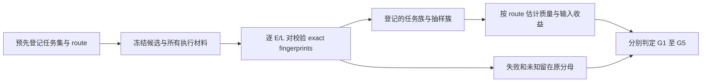

# 工具按需加载：正式验收的冻结、任务族与预算设计

日期：2026-10-13。状态：**历史冻结方法，尚未作为正式试验执行。** 本文承接原五项标准；用户已明确采用[高置信全任务净收益目标](2026-10-13-tool-loading-net-benefit-pilot_CN.md)，旧统一数值门槛不再是现行通过线。两层登记与冻结纪律继续复用；质量估计量、任务权重、实际收益界和预算须按新方案预先决定，不能静默重解释旧字段。CLIProxyAPI 为实施载体，Codex、Claude Code 为重点，OpenCode 非重点；不发布、不切换默认配置、不重启原服务。

## 为什么不能继续只重复现有模板

现有 pilot 已证明部分 route 的实际闭环与输入收益。T17 原始/选择性发现共 20/24 safe，T19 新诊断候选 4/4 safe；均是三个单函数任务或其中一个任务。提示直接给出工具全名，不能代表自然语言发现；模板变体高度相关，不能当作独立样本。诊断、模板与 Gateway revision 变化后再反复拼接通过次数，也不能成为同一最终候选的质量认证。

当前配对分析按 exact fixture/permission scope 分组，每个编码任务常只有一对。**增加不同任务后，如果仍按每个任务的精确 fixture hash 分组，依然无法得到代表性簇；删除这些 hash 强行合并也不正确。** 下一步需要两层登记与验证。

## 两层证据，逐对验证后才允许按任务族统计

| 层次 | 必须保留 | 用途 |
| --- | --- | --- |
| Exact case / pair | baseline revision、fixture/gold/prompt/catalog/permission hash、工具服务/客户端/harness 版本、Gateway binary SHA/revision、模型/协议/路由、凭据材料绑定、E/L 模式、预算、实际身份及 journal | 判定这一对是否真的可比较，拒绝材料漂移与历史改判 |
| Experiment / family | 完整预登记 task-set digest、每项任务的 exact hashes、任务族定义、独立抽样簇、route 列表、权重、重复次数、随机顺序、缓存实验条件、统计方法与停止规则 | 只有登记的任务变化可以在这一层聚合；既不丢掉 exact 证据，也不把每项不同 fixture 拆成不可统计的孤立认证 |

新任务集、任务族或分析方法必须在采样前登记。不得事后把已有“好看”的任务归入新族、删除失败任务，或拿同一 bug 的数字/文案变体冒充独立簇。[task_registry.py](../../../ops/tool-loading/task_registry.py)现已实现 opt-in 登记与条件性分析：完整 CaseSpec 摘要、sampling frame、材料与 seed 在首任务前绑定，重复和伪拆分有负向回归。尚未自动接入 live runner，也未证明抽样代表性、实现自定义族权重或交付编码 fixture；旧 `unverified` 结果不因此获得认证。

工具身份必须证实。凭据 byte SHA 只证明材料绑定，不证明账号身份；region、账单与缓存信息的未知分别报告。与某指标无关的未知不能被擅自填成已知，也不能自动当作该指标的零值。若输入 usage 已完整可信，未知账单不应被转写为“输入未知”；Gemini 当前的输入计量冲突则确实阻止其输入收益认证。

## 分开覆盖检索、编码与生命周期

| 任务族 | 需要的新证据 | 不能替代它的已有证据 |
| --- | --- | --- |
| 自然语言发现 | 中文/英文意图、同义描述、相似工具名、零结果、无适用工具；不提示准确工具名；发现清单的真实声明、权限与实际调用 | exact-name selective prompt 的通过次数 |
| Repository 编码 | 固定 repository baseline 的多文件修改、独立 host gold、真实 diff、规定的工具调用与合法终态；任务族至少覆盖解析/数据变换、API 行为、错误处理、并发或取消、回归修复 | 单函数的 11 项测试或全部 test executions 之和 |
| 协议与安全 | 声明位置、多轮激活、预算/重试、SSE/WS、禁止工具/非法参数、取消、权限变更、资源释放 | 仅正常路径成功或进程 exit=0 |

Repository 工具应提供限定 workspace 的读、带 expected tree revision 的原子 patch、host-owned tests；不能把任意 shell 命令当作新的统一执行接口。所有参数和权限先验证，再产生代码写入/测试进程；gold 与 runner 不可被模型修改。测试进程的执行隔离、取消和资源释放须先验证；不存在已验证边界时，任务保留未验证，不能用单文件 toy 替代后宣布代表性认证。该执行端扩展尚未实施。

无适用工具时，正确拒绝且零 dispatch 可以是任务成功；需要工具的编码任务则必须有实际执行、代码结果与合法终态。相对质量非劣不能覆盖某条 route 双模式都失败的闭环事实。

## 正式冻结顺序与范围

1. 先补 MCP repository fixture、族级分析契约及客户端需要的检索/取消交付，完成确定性回归与 bounded pilot。候选迭代的旧分母、失败、重试、未知值全部保留。
2. 按必选客户端/模型/协议/route 列出能力与未知项；Codex Code Mode、原生 `tool_search`、Claude ToolSearch 分别声明。不能静默移除 Gemini 或改成其他账号/协议来凑通过率。
3. 锁定最终 Gateway binary 与 revision、客户端执行文件、工具服务与 harness、声明/权限/gold、opaque credential binding、config/policy fingerprints。报告 commit 可以随后更新，但执行候选和冻结材料不能跟着变化。
4. 以该候选执行至少 60 个跨供应商案例及代表性编码任务。可由多个预先冻结的 run 组成，但保留各自 plan/journal 和统计边界；“单一最终版本”不等于“必须一个 run”。不得继承旧 revision 的正向认证。
5. 再按预登记抽样设计收集质量与收益样本。若途中修复执行逻辑或材料变更，新候选重新冻结；旧结果留作历史，不偷换成最终版本样本。

## 统计门槛及样本规模

现行要求：每 route 成对质量差 `safe_success_lazy − eager` 的单侧 95% 下界 ≥ −2pp；first/peak 输入成对中位数减少 ≥45%，全任务输入或已知成本减少 ≥10%，收益区间下界 >0。延迟、缓存与账单各自报告，不合并不同 Provider tokenizer 的原始 tokens。

若一个独立代表性簇出现 eager 成功而 lazy 失败，记为回归簇。零观察回归时，其概率的单侧 95% 上界为 `1 − 0.05^(1/n)`。质量差不低于负的回归概率，因此这个上界可提供保守质量界：148 簇约 2.0038%，149 簇约 1.9905%。**149 是理想零回归设计的下限示例，不是存在回归时的完整 power 方案，也不证明已有固定模板具备独立性。** 收益的顺序统计下界同样需要代表性、独立簇；当前一至三簇不足。

| 声明方式 | 十个 client/route 单元的零回归示例 | E/L cases | 每 case 八请求的累计上限 |
| --- | --- | --- | --- |
| 当前逐 route 单侧 95% | 每单元 149 独立簇 | 2,980 | 23,840 |
| 可选的整体同时 95%，Bonferroni | 每单元 263 独立簇 | 5,260 | 42,080 |

第二行并非用户现行强制要求；它约增加 76.5% cases/请求上限，必须另作明确决定，不能悄悄提高标准。重复同一模板不会降低这一独立样本要求。上述请求是预算上限，不是预期请求数或货币费用；任务预算、Provider 配额与真实费用还未形成可用投影。

## 预算和停止规则必须先锁定

- 明确总 cases、总物理请求、dispatch、全任务输入预算或可核实费用上限、时间预算、并发与 Provider 配额条件；auxiliary 调用计入实际请求和未知成本。当前不能给出可信美元费用。
- 序贯观察时预先指定允许的中期检查及其统计方法；不能在置信结果第一次“好看”时停跑，然后继续沿用固定样本 95% 的名义覆盖率。
- 配置/材料漂移、真实断流、身份不明、预算耗尽、Provider 429、模型代码失败、非法执行或释放失败均留在已开始分母，记录主要原因和并存的其他事件。证据缺失标未知，禁止补零或无限重试。
- 安全/协议失败可暂停该路径收样以修复，但不能抹去此前结果；计划中尚未开始的任务单独计 `planned_not_started`。超过预登记预算不继续扩样。

正式大规模执行前，需要完成具体任务清单、族级分析契约及可评审的预算/停止表。当前未批准也未启动 2,980 或 5,260 案例的试验。

## 当前起点与未完成事项

执行候选当前为 `58f5523b`；[四例校准](../../acceptance/2026-10-13-response-diagnostics-calibration_CN.md)已有实际闭环和正常诊断封存。[六十例复测](../../acceptance/2026-10-13-final-candidate-60-retest_CN.md)已完成 60 started / finished、41 safe，数量覆盖完成，失败与未知计数保留；它没有预登记新任务族，不能事后升级认证。[Codex MCP 取消](../../compatibility/codex-mcp-cancellation-gap_CN.md)、[多输出保真](../../compatibility/codex-code-mode-multiple-results_CN.md)、[Gemini 权威计量](../../acceptance/2026-10-13-gemini-usage-boundary_CN.md)、repository fixture、登记 runner 集成和正式族级统计仍未闭合。以上未知项不因输入点估计达到 45% 就变为已解决。
