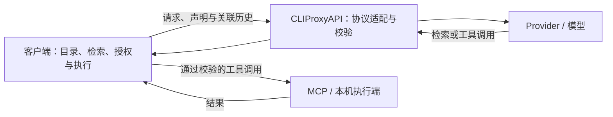

# 工具按需加载配置手册：Claude Code、Codex、OpenCode 与 CLIProxyAPI

核验日期：2026-10-14（Asia/Shanghai）。本手册面向已有 Provider 接线和 MCP 工具目录的用户，说明如何启用、确认及关闭工具按需加载。配置示例均为需要合并的局部片段，不是可覆盖现有文件的完整配置。

本机已验证的版本如下。升级客户端、切换模型或更换路由后，需要重新验证；表中的结论不能外推到全部版本和 Provider。

| 端 | 核验版本 | 本次采用的机制 | 生效条件 |
| --- | --- | --- | --- |
| Claude Code CLI | `2.1.296` | 原生 `ToolSearch` | 新启动 CLI 会话，目标模型和路由接受发现协议 |
| Claude Code Desktop | App `2.31226.1`；内嵌引擎 `2.1.295` | 桌面官方 `toolSearchEnabled` | 修改活动配置，完全退出并重新打开 App |
| Codex CLI | `0.162.1` | Code Mode 内的 `tools.tool_search` | 新进程加载配置，实际模型 metadata 允许工具发现 |
| Codex App 内嵌引擎 | `0.162.0-alpha.17.2` | Code Mode 内的 `tools.tool_search` | App 使用同一配置目录；新会话或重载后的行为另行确认 |
| OpenCode | `1.19.0` | `execute` 内的 `tools.$codemode.search` | 启动 OpenCode 的进程继承启用变量 |
| CLIProxyAPI | `v1.3.2-upstream8.0.23` | 路由适配、声明激活、身份及历史保护 | 客户端实际发起发现；核心处理未被关闭 |

## 1. 先明确配置分别归谁

客户端持有 MCP 注册目录，负责检索、授权、执行和结果回填。CLIProxyAPI 根据实际路由适配协议，不执行 MCP，也不会自动替一个全量加载的客户端生成工具检索流程。



原生 `ToolSearch` 与 Code Mode 是不同入口。前者通过搜索调用及工具声明或引用加载工具；后者让模型通过代码执行入口检索、访问嵌套工具目录。两者都可能减少初始声明，但仅看到 `ToolSearch` 或 `execute` 这个名字，不足以证明已经节省 token。

开始前确认：

- 目标工具已在该客户端注册且可以连接；另一个客户端能看到它，不代表当前客户端也能看到。
- 当前模型、Provider、endpoint 和代理路由已能正常对话；启用发现不需要更换默认模型或重建凭据。
- 记录将要修改的键原值，以及该键原先是否缺省；只合并本次字段，保留其他配置。
- 不需要自行构建 Codex、Claude Code 或 OpenCode，也不需要安装历史 tool-search shim。

## 2. Claude Code CLI

### 2.1 启用

确认版本：

```bash
claude --version
```

在用户配置 `~/.claude/settings.json` 的既有 `env` 对象中合并：

```json
{
  "env": {
    "ENABLE_TOOL_SEARCH": "true"
  }
}
```

保留已有 `ANTHROPIC_BASE_URL`、模型、认证、权限、插件和 hooks。这里的 `"true"` 是环境变量字符串。

如需只验证一次，不写持久配置，可在 POSIX shell 中启动：

```bash
ENABLE_TOOL_SEARCH=true claude
```

使用自定义 `ANTHROPIC_BASE_URL` 时，Claude Code 默认可能回退到全量加载；显式 `true` 用于覆盖这一代理回退。它不会让不受支持的模型自动获得发现能力。官方取值还包括阈值模式 `auto`、`auto:N` 和关闭值 `false`；本手册采用已实测的 `true`。[官方配置说明](https://code.claude.com/docs/en/mcp#configure-tool-search)

### 2.2 检查冲突与生效

重新启动 CLI 会话。若仍没有搜索能力，检查有效配置中是否存在：

- `CLAUDE_CODE_DISABLE_EXPERIMENTAL_BETAS` 或组织受管策略关闭工具搜索。
- `permissions.deny` 禁止 `ToolSearch`。
- MCP 服务的 `alwaysLoad` 设置要求全量加载，或工具 metadata 要求提前加载。
- 项目、会话启动参数或宿主传入的配置覆盖用户设置。

不要通过关闭权限控制解决发现问题。受管策略的变更应沿组织已有管理流程处理。

### 2.3 验证与关闭

在会话中先确认目标 MCP 已注册，再使用第 7 节的发现提示和只读闭环提示。实际证据应包含 `ToolSearch` 调用、发现结果及目标工具调用后的回填。

关闭时可把 `env.ENABLE_TOOL_SEARCH` 改成 `"false"`，随后重启 CLI 会话。若要恢复修改前状态，则恢复原值；原来缺省就删除此次新增的键。删除键与显式 `false` 的行为不同。

## 3. Claude Code Desktop：第三方推理 / Gateway 模式

### 3.1 桌面有独立开关

桌面的官方配置键为布尔值 `toolSearchEnabled`，在第三方配置中的默认值是 `false`。不能仅修改终端 CLI 的 `ENABLE_TOOL_SEARCH` 就认定桌面生效。[桌面配置参考](https://claude.com/docs/third-party/claude-desktop/configuration)

优先通过 App 的第三方推理配置窗口维护现有配置。若直接核对 macOS 本地文件，配置库位于：

```text
~/Library/Application Support/Claude-3p/configLibrary/
```

该目录中的 `_meta.json` 标识活动配置，配置正文为同目录下的 `<id>.json`。本机版本实测使用 `_meta.json.appliedId`。不要只挑一个看起来最新的 JSON 文件，也不要为此修改 `appliedId`。

下面的命令仅输出活动路径和开关，不输出完整配置或凭据：

```bash
python3 - <<'PY'
import json
from pathlib import Path

root = Path.home() / "Library/Application Support/Claude-3p/configLibrary"
meta = json.loads((root / "_meta.json").read_text())
profile = (root / f'{meta["appliedId"]}.json').resolve()
assert profile.parent == root.resolve(), "Unexpected profile path"
data = json.loads(profile.read_text())
print("active_profile:", profile)
print("toolSearchEnabled:", data.get("toolSearchEnabled", "<unset>"))
PY
```

如存在覆盖该配置的 MDM 或其他受管来源，应核对该来源。活动本地文件的值不能证明最终有效值。

### 3.2 修改活动配置并重载

只在确认的活动配置顶层合并：

```json
{
  "toolSearchEnabled": true
}
```

这里是 JSON 布尔值，和 CLI 环境变量的字符串不同。保留现有推理 Provider、gateway URL、认证、模型映射和其他字段。

等待所有运行任务结束后，完全退出 App，再重新打开。仅关闭窗口不足以确认新配置已加载。客户端重载与 CLIProxyAPI 服务重启是两件事，此设置不要求重启网关。

官方说明：Gateway 模式且内嵌 Claude Code 不低于 `2.1.247` 时，桌面采用针对 gateway 的工具搜索请求形态。其他部署模式、旧引擎和受管策略需要分别核对，不能照搬本次结果。[桌面模式与生效条件](https://claude.com/docs/third-party/claude-desktop/configuration)

### 3.3 Muse 路由注意事项

客户端显示名、Claude 兼容模型 ID 和真实上游模型可能不同。本次桌面显示为 `opencode-go-muse-spark-1.3`，上游实际报告为 `muse-spark-1.3-contributor`。应沿用现有映射，按实际请求确定路由，不为启用搜索而重命名模型别名。

本次已验证当前桌面会话通过 Muse 完成“搜索—加载—调用 `list_terminal_tabs`—结果回填”。`Loaded tools` 是客户端行为线索，最终判定仍需结合 wire 请求和实际执行记录。

关闭时将活动配置的 `toolSearchEnabled` 设为 `false` 后完整重载；恢复原状态则按原值或原缺省状态还原。

## 4. Codex CLI

### 4.1 使用当前版本支持的入口

先查询安装版本及实际可用开关：

```bash
codex --version
codex features list
```

本次 `0.162.1` 将旧 `tool_search` 标为 `removed`。不要把 `features.tool_search=true` 或 `tool_search_always_defer_mcp_tools` 当作当前有效的启用方法。

本次采用官方客户端已有的 Code Mode。通过官方命令合并配置：

```bash
codex features enable code_mode
codex features enable code_mode_tool_search
```

对应 `~/.codex/config.toml` 的局部结果为：

```toml
[features]
code_mode = true
code_mode_tool_search = true
```

如果已有 `[features]`，应合并字段，不能再追加一个重复表头。本版本也接受 Code Mode 的结构化配置形式；布尔值和同名配置表不要同时定义。

两个开关在本次版本中均标为 `under development`。官方配置参考列出了 Code Mode 的配置入口；`code_mode_tool_search` 的本次可用性还由安装版本的 `features list` 和真实请求验证，不能只根据网页缺省清单推断。[OpenAI Docs 配置参考](https://learn.chatgpt.com/docs/config-file/config-reference)

Code Mode 所需宿主与运行时也必须在官方安装中正常可用。开关不负责安装依赖；若宿主启动失败，应先检查官方安装完整性和客户端启动诊断。

### 4.2 模型 metadata 与配置覆盖

`code_mode_tool_search` 负责将发现能力接入 Code Mode；它不代替模型和路由的能力判断。当前有效模型 metadata 中的 `supports_search_tool` 仍参与发现启用。

已有自定义模型目录时，使用其原有管理流程及当前客户端 schema 核对条目。该字段属于模型 metadata，不是可随意新增到顶层 TOML 的开关。仅把它改成 `true` 也不构成跨 Provider 兼容性证据。

还需核对启动时的 `CODEX_HOME`、profile、受信任项目配置和命令行覆盖项。不要用缺少依据的 `supports_namespace_tools` 等字段替代真实能力验证。

### 4.3 验证与关闭

新启动一个 Codex 会话，先运行第 7 节的发现验证。本次实测记录是 `exec` 内执行 `tools.tool_search(...)`，客户端返回匹配工具的有效声明，再产生合法终态。

如需记录非交互事件，可在一个已配置好目标 MCP 的目录执行：

```bash
codex exec --json --ephemeral --skip-git-repo-check --sandbox read-only \
  '请仅通过工具发现检索已注册的 Hindsight 知识页搜索工具，返回精确名称。不调用目标工具，不执行 Shell，不读写文件，不做网络搜索。'
```

该示例使用当前模型及路由，不切换默认配置。若当前客户端没有注册 Hindsight，应换成已注册工具的关键词。

关闭本次新增的 Code Mode 开关可执行：

```bash
codex features disable code_mode_tool_search
codex features disable code_mode
```

这只关闭相应 Code Mode 功能，不能据此断言所有原生工具发现也已关闭。精确回退应恢复这两个键各自的原值；本次原先均缺省，完全回退应删除新增键，保留其余 features。

## 5. Codex App

### 5.1 配置共享的前提

本机 App 与 Codex CLI 使用同一份 `~/.codex/config.toml`，因此第 4 节的两个开关同时适用于内嵌引擎。其他安装若使用不同的 `CODEX_HOME`、配置 profile 或宿主管理设置，需要在 App 实际使用的配置中核对。

App 版本和内嵌引擎版本是两个维度。本次内嵌引擎来自 `ChatGPT.app` 的官方分发，版本为 `0.162.0-alpha.17.2`；不能拿独立 CLI 的 `0.162.1` 代替它的版本记录。

### 5.2 生效及验收边界

保存配置后，在 App 的新会话中执行发现验证；需要重载时，先等待其他任务完成。不要为验证一个开关中断仍在执行的任务。

本次已确认内嵌官方引擎读取两个开关为 `true`，并在独立临时会话中通过 CLIProxyAPI 的 GPT 路由执行 `tools.tool_search`、收到工具声明并完成响应。该证据确认内嵌引擎能够工作；正在承载本任务的桌面对话没有重启，其配置热加载状态仍为未验证。

当前对话是否出现发现入口、是否真正执行检索，以及声明是否按需进入后续模型请求，应分别记录。不能用单独启动内嵌引擎的结果替代桌面当前会话验收。

关闭或回退沿用第 4 节；新会话或重载后的 App 行为需要再次确认。

## 6. OpenCode 1.19.0

### 6.1 启用 Code Mode

本次已安装版本识别的开关是环境变量 `OPENCODE_EXPERIMENTAL_CODE_MODE`。一次性启动：

```bash
OPENCODE_EXPERIMENTAL_CODE_MODE=1 opencode
```

macOS 使用 zsh 时，可在已有 `~/.zshenv` 中保留其他内容并增加一行：

```bash
export OPENCODE_EXPERIMENTAL_CODE_MODE=1
```

新开终端，或在当前终端加载修改后的文件：

```bash
source ~/.zshenv
printf '%s\n' "$OPENCODE_EXPERIMENTAL_CODE_MODE"
opencode --version
```

期望变量输出为 `1`。已经运行的 OpenCode 进程、旧 shell、服务进程和 GUI 启动环境不会因为修改文件自动继承新值。应在实际启动入口设置环境，并重新启动相应客户端进程；无需重启 CLIProxyAPI。

没有核验过其他平台的持久化启动链；不要把 zsh 的配置路径当作 Windows、Linux 服务或 GUI 应用的通用配置位置。

### 6.2 配置范围及验证

保留现有 `~/.config/opencode/opencode.json` / `opencode.jsonc` 中的 Provider、模型、插件、权限及 MCP 定义。本次默认模型未切换，验证调用通过命令行选择已有 `cliproxyapi/gpt-6-luna` 路由。

若你的配置已有这个路由，可单次验证：

```bash
OPENCODE_EXPERIMENTAL_CODE_MODE=1 opencode run --format json \
  --model cliproxyapi/gpt-6-luna \
  '请仅通过 Code Mode 目录搜索已注册的 Hindsight 知识页搜索工具，返回精确名称。不调用目标工具，不执行 Shell，不读写文件，不做网络搜索。'
```

没有该路由时，使用自己已经配置的 `provider/model`；不要为照抄示例而新增凭据或切换默认模型。MCP 必须在该次运行实际使用的配置作用域内注册。

本次真实输出为 `execute` 执行 `tools.$codemode.search(...)`，返回匹配工具的签名。这是 OpenCode 的 Code Mode 目录搜索，不是 Anthropic 的原生 `ToolSearch`。

该环境开关由已安装 `1.19.0` 二进制及真实请求核验。官方配置文档没有为本次开关提供足够说明；不因此杜撰 `experimental.code_mode` JSON 字段，也不套用 OpenCode V2 的 `codemode` 配置。[OpenCode 配置参考](https://docs.opencode.ai/docs/config/)

### 6.3 关闭与回退

一次性关闭可执行：

```bash
OPENCODE_EXPERIMENTAL_CODE_MODE=0 opencode
```

持久回退时，恢复启动配置中该变量的原值；本次原先缺省，应移除新增的 export，在当前 shell 执行 `unset OPENCODE_EXPERIMENTAL_CODE_MODE`，再启动新的 OpenCode 进程。只删除文件中的一行，不会清除旧 shell 已继承的值。

## 7. 统一验证：配置、发现、执行和用量分开看

### 7.1 先验证发现

为当前客户端选择一个已注册、尚未加载的工具，用具体功能关键词替换下面的占位文本：

```text
请使用 ToolSearch 或当前客户端的 Code Mode 目录搜索，查找【已注册工具的具体功能】。
只返回精确工具名；不调用目标工具，不执行 Shell，不读写文件，不做网络搜索。
```

应在实际事件或请求链中看到搜索入口被调用，以及客户端返回有效工具声明或引用。模型直接说出一个工具名，不证明搜索实际发生；先前已加载的工具也不能用于证明本轮按需发现。

### 7.2 再验证只读闭环

选择一个确认无副作用的工具。Claude 桌面本次使用的例子如下；其他客户端未注册 terminal 服务时，应换成自身已注册的只读目标。

```text
请通过工具搜索找到 terminal 的 list_terminal_tabs，只调用一次，最后仅报告标签页数量。
不要读取终端内容，不运行命令，不读写文件。
```

成功闭环应同时具备：搜索调用、被发现的有效声明、一次真实工具执行、对应 call ID 的成功结果回填，以及后续模型响应的合法终态。搜索成功和任务完成是两个判断。保留已有授权与参数校验；不得通过放开全部权限来使验证通过。

### 7.3 用实际请求和 usage 判断上下文效果

| 观察点 | 能证明什么 | 单独不能证明什么 |
| --- | --- | --- |
| 开关为 true、features list | 配置或客户端解析状态 | 当前桌面对话已热加载、Provider 已兼容 |
| `Loaded tools`、工具名或 `execute` 出现 | 客户端提供了相关入口或界面提示 | 检索真正执行、目录实际减少 |
| 出站声明及历史 | 哪些声明已进入该次请求 | 精确 token 数或账单 |
| MCP 调用及关联结果 | 实际执行与回填 | 任务质量、全任务收益 |
| 上游最终 usage | 该次请求报告的用量 | 未报告费用、其他模型或整个任务用量 |

检查声明时，覆盖顶层 `tools`、`input[].additional_tools`、发现结果和 Code Mode 指令或目录；不能只数顶层工具。部分客户端协议可以在 HTTP 正文中保留完整候选定义，但将其延后进入模型上下文，因此请求字节数也不能单独当作上下文占用。

逐请求记录 `input_tokens`、已报告的缓存输入、`output_tokens`、实际模型和终态。优先采用 Provider 最终 usage，而不是 UI 预估或流开始时的估算。Claude usage 若把新输入与缓存读写分列，应按对应路由的定义统一口径，避免漏算或重复累加；转写记录按响应或 message ID 去重。

首轮是任务的第一个实际模型请求；峰值是该任务最大的单次请求输入；全任务累计是全部实际请求输入之和，包含发现、历史重传、失败及重试，能够归属的辅助模型请求另列。各指标分别计算 `(eager - lazy) / eager`，所以累计减幅可以高于首轮或峰值减幅。输入减少不等于账单减少；未知用量、缓存、延迟或费用保持未知。完整口径见 [token 使用报告](token-usage-report_CN.md)。

## 8. CLIProxyAPI 与 MCP 执行端

### 8.1 网关通常沿用缺省配置

本版本由核心处理工具协议，不依赖插件。`requests.responses-tools` 是策略的唯一入口，整块缺省时按实际路由采用约定行为。若需要显式表达开启，可在已有 `requests` 下合并：

```yaml
requests:
  responses-tools:
    enabled: true
```

本机实测运行配置为 `/opt/homebrew/etc/cliproxyapi.conf`。其他部署以服务实际启动时的 `--config` 为准，不能假定仓库 `config.yaml` 就是活动配置。

不要为了“启用 ToolSearch”给所有路由强制写入 `native`，或全局打开 schema 展开、required 补齐、custom 降级。模型别名不决定上游能力；需要覆盖时，按实际 provider、auth kind、upstream model、format 和 endpoint 精确匹配。配置枚举、预算、Meta/Muse 约定、位置语义及 WebSocket 边界见[协议指南](../responses-tools_CN.md)，不在客户端手册中维护第二份规则。

客户端仍在全量发送工具且没有任何发现声明时，先修客户端配置；网关不会凭空创建一个客户端无法执行的搜索入口。反过来，客户端已经搜索但上游缺少激活声明、身份或合法流终态时，应定位网关或 Provider 的协议边界。

### 8.2 MCP 执行端保留原协议和权限

保持 MCP 工具注册、`tools/list` 与 `tools/call` 可用。无需为了按需加载删除大部分 MCP 注册项，也不需要给每个服务增加一个名为 ToolSearch 的工具。

搜索命中不等于执行授权。执行端和客户端仍按当前权限及原始参数 schema 校验，并处理取消和资源释放。Code Mode 下的嵌套调用也应经过原有权限链。

### 8.3 请求日志只作为短时诊断

确实需要 wire 证据时，可在获得相应运行配置变更授权后，短时启用现有日志键：

```yaml
observability:
  logs:
    request-log: true
```

日志可能包含提示、代码、工具声明和结果。限定访问范围，仅提取必要字段，不输出完整配置、Authorization 或业务正文。验证结束后恢复该键修改前的值或缺省状态，核对恢复结果；不要把开启全文日志作为长期性能测量方案。本次验证使用热加载并恢复原始配置，没有重启 CLIProxyAPI。

若紧急关闭 `requests.responses-tools.enabled`，应同时规划依赖发现的客户端回退；网关关闭不等于客户端已经转为 eager。切换前排空活跃请求，避免中途改变协议语义。

## 9. 本次实测结果与常见问题

### 9.1 实测范围

| 端与路由 | 本次已确认 | 未认证范围 |
| --- | --- | --- |
| Claude Code CLI → CLIProxyAPI → Muse | 原生 `ToolSearch` 返回已注册工具，正常结束 | 全模型兼容、全任务收益 |
| Claude Code Desktop → CLIProxyAPI → Muse | 搜索、加载、一次真实 MCP 调用、回填及终态 | 所有桌面模式和模型、长期可靠率 |
| Codex CLI → CLIProxyAPI → `gpt-6-luna` | Code Mode 搜索返回声明，正常结束 | 所有模型/Provider、这次探测中的目标 MCP 执行 |
| Codex App 官方内嵌引擎 → 同一 GPT 路由 | 新临时会话搜索返回声明，正常结束 | 当前桌面对话热加载、App 当前会话的完整 MCP 闭环 |
| OpenCode → CLIProxyAPI → `gpt-6-luna` | `execute` 中搜索返回签名，正常结束 | OpenCode V2、所有插件组合和 Provider、此次目标 MCP 执行 |

五次独立 CLI / 内嵌引擎探测中，Claude CLI 首次选择了该 CLI 未注册的 SpeechRail 目标，三轮预算耗尽；改用已注册工具后复核成功。失败记录没有从统计中删除，也没有据这五次探测计算可靠率；桌面当前会话的闭环证据另列。

### 9.2 Muse 的实际输入变化

同一项目、同一路由、同一短提示的两次不同会话请求：

| 指标 | 全量加载基线 | 启用后 | 变化 |
| --- | ---: | ---: | ---: |
| 单次请求上游 `input_tokens` | 84,470 | 35,136 | 减少 58.40% |
| 其中 `cached_tokens` | 0 | 0 | 两次均无缓存输入 |
| 上游请求工具数 | 193 | 30 | 减少 163 个 |
| 上游请求 MCP 工具数 | 167 | 18 | 减少 149 个 |
| 上游 `tools` 紧凑 JSON 的 UTF-8 字节数 | 252,308 | 47,543 | 减少 81.16% |

短提示为“验收标记 cpa-muse-context-20261014：请只回复 OK，不调用工具，不读取或修改文件。”基线响应 ID 为 `resp_6acf230e42d8f7fc34c64ad0`，启用后为 `resp_6acf28ef98e836e5ff83420c`；实际模型均为 `muse-spark-1.3-contributor`，均合法完成。

这些数值来自上游最终 usage。短提示已处于各自会话的后续轮次，不应标成首轮输入。会话状态没有完全冻结，因此是有限观察，不是严格成对实验、全任务节省或账单节省，也未建立收益置信区间。

本段保留可参考的结果与口径，不依赖系统 tmp 中一次性文件长期存在，也不与此前固定编码任务的终版数据合并统计。生产编码任务数据仍以现有[token 使用报告](token-usage-report_CN.md)为准。

### 9.3 排障速查

| 现象 | 优先检查 |
| --- | --- |
| Claude CLI 已开，桌面仍全量 | 桌面活动 profile、`toolSearchEnabled`、受管覆盖及完整重载 |
| 配置为 true，但没有发现入口 | 客户端版本、有效模型 metadata、实际配置目录、profile 与覆盖参数 |
| Claude 搜索不到另一个客户端能用的工具 | 当前客户端的 MCP 注册作用域、连接状态与关键词；不要反复加轮次掩盖目录缺失 |
| Codex 旧开关看起来存在 | `features list` 是否标为 removed；使用本版本验证过的入口 |
| OpenCode 新终端有效，旧终端无效 | 启动进程是否继承环境变量；旧服务或 GUI 是否需要单独启动设置 |
| 搜索成功，调用未发生 | 是否只是发现探测、预算是否耗尽、声明是否有效、当前权限是否允许 |
| Provider 返回 400/422 | 实际 endpoint 与协议、延迟引用、激活声明、精确错误阶段；不要先关闭参数或权限校验 |
| 上下文仍高 | 保留的基础工具、提前加载项、Code Mode 目录说明、系统指令、技能、记忆和历史；分别核对实际请求 |
| 首轮更小，全任务输入或延迟增加 | 搜索、推理、重试、历史回传及缓存变化；分别报告，不能用首轮减幅替代 |
| 发生断流但客户端似乎完成 | 核对真实 Provider 终态与已回填结果；不得把截断补成成功 |

## 10. 维护入口

客户端或 gateway 升级后，重新记录版本和有效开关，验证一个新会话中的发现及只读闭环，再核对实际请求和最终 usage。协议处理与更多路由的既有证据分别见：

- [Responses 客户端工具协议与配置](../responses-tools_CN.md)
- [设计与实施依据](design-and-implementation_CN.md)
- [验证与兼容报告](verification-and-compatibility_CN.md)
- [逐请求 token 使用报告](token-usage-report_CN.md)
- [保留的官方客户端性能复现工具](../../ops/tool-loading/README.md)

本手册对应的是已核验配置和明确边界，不自动授权发布、安装、修改运行配置或重启服务。新的客户端启用和路由变更应沿用现有授权及变更流程。
