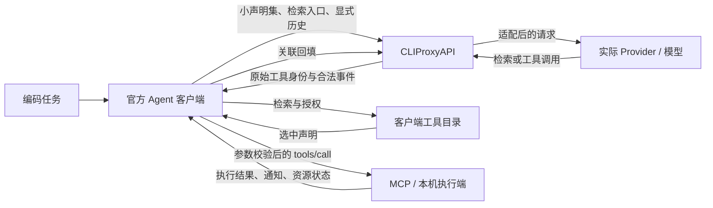
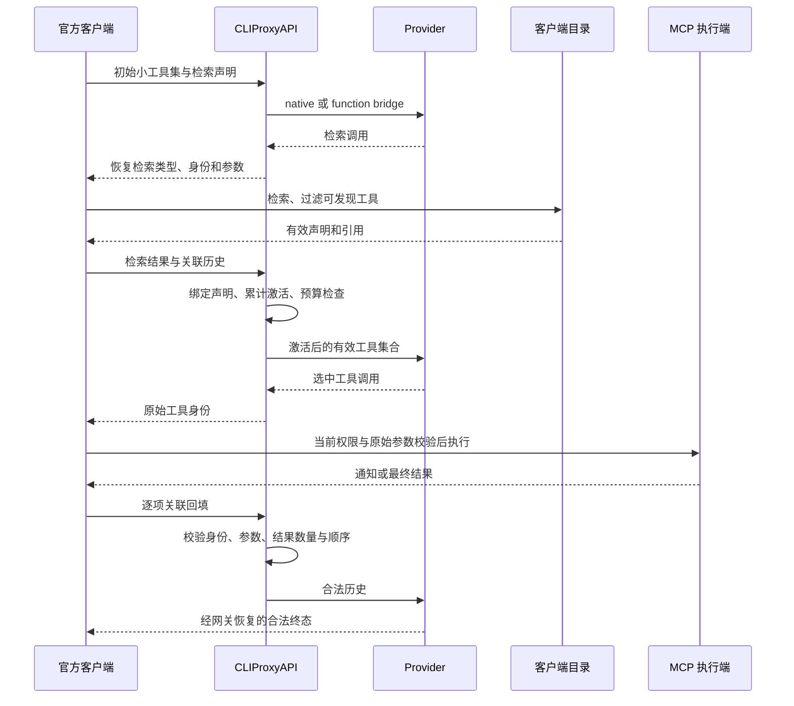

# 跨 Provider 工具按需加载：设计与实施依据

核验日期：2026-10-14（Asia/Shanghai）。生产代码基准：`743a5e0ae14d100b2c1c8f2101b93adfa420269e`，交付位于 [PR #25](https://github.com/hrygo/CLIProxyAPI/pull/25)。本文描述已实现行为及有效实施边界；工程和运行证据见[验证与兼容报告](verification-and-compatibility_CN.md)，用量数据见[token 使用报告](token-usage-report_CN.md)。公开接口的配置细节见[协议指南](../responses-tools_CN.md)。

## 1. 目标与交付范围

CLIProxyAPI 是生产修复和优化的主要载体。官方发行的 Codex、Claude Code 是主要客户端，OpenCode 是补充兼容对象。目标是在明确客户端版本、模型、实际路由和传输范围内，保持“发现—加载—调用—结果回填”的协议闭环，降低不必要的大工具目录注入，保护任务质量、工具身份、权限边界和结果语义。

实施判断以具体生产缺陷、可解释的收益和最小充分验证为依据。Agent 的工具选择、轮次和结果有波动；有限样本中的百分比是观察结果，不能变成普遍承诺。质量、全任务输入、缓存、延迟和费用分别评价。失败、预算耗尽和未知项是结论的一部分。

交付包括网关协议适配、声明激活、历史与身份保护、预算、最终发送校验、诊断和生产 Go 回归。不包含客户端源码 fork 或自建客户端、任务库与 benchmark 平台扩建、默认配置切换、安装、发布或服务重启。实验脚本已经从生产 PR diff 移出；原工作区和 Git 历史保留。

旧方案中的 60 例数量、−2pp 质量界及 45%/10% 收益数值属于历史验收设计。它们没有被追溯改判为通过，也不是继续建设测试设施的前置条件。当前交付标准是具体问题得到可验证的网关修复，适用范围清楚，正常路径保留，失败和不确定性如实报告。

## 2. 架构与上下文收益来源

全目录工具名称、说明和 schema 进入每次模型请求时，即使工具未被使用，也占输入资源。按需加载把初始模型可见面缩为基础工具和检索入口，后续仅加载被发现的声明。收益取决于客户端确实延迟声明、模型找到正确工具、激活声明有效以及结果能够继续回放。

检索也消耗请求和输入。宽泛检索可能把完整 metadata 或 schema 放进结果历史；额外推理、重试、输出与缓存条件可能抵消首轮收益。网关不能通过删除真实结果或伪造执行来制造节省。声明 JSON 字节、Provider input tokens 和账单是三个不同指标。

## 3. 职责及供应商依赖

| 层次 | 所有权与已实现职责 | 不能由该层替代的事实 |
| --- | --- | --- |
| 官方 Agent 客户端 | 目录注册、检索、模式启用、工具加载、当前授权、执行调度和结果回填 | 网关声明支持不能证明客户端真正延迟加载或正确取消。 |
| CLIProxyAPI | 按实际路由选择策略，转换协议，累计激活，维护身份，保护最终发送和流终态，输出有限诊断 | 不运行 MCP，不拥有客户端 MCP request ID，不授予权限，不替模型选择工具。 |
| Provider / 模型 | 接受实际 wire contract，产生检索或调用，返回真实终止信号与用量 | 使用 Responses 格式不等于支持原生搜索、多结果、grammar 或相同 usage 口径。 |
| MCP / 执行服务 | 按当前权限和原始 schema 在执行前拒绝非法调用，执行工具，处理取消、回执和释放 | 检索结果不构成授权，历史声明不构成当前权限；进程退出不等于取消通知已收到。 |
| 运行配置与运维 | 明确版本、credential scope、模型与 endpoint，保留变更来源和可回退材料 | 配置漂移、上游限流和缺失计量不能用换账号或静默改配置掩盖。 |

这项技术不以某一 Provider 的工具检索 API 为唯一前提。模型能够稳定调用普通函数，客户端能够本地检索并回填声明时，网关可用 function bridge 保留检索闭环；原生工具检索仅在有效协议和实际路由允许时采用。能否跨 Provider 跑通仍由客户端模式、目标协议、模型输出和执行端共同决定，兼容转换没有消除这些依赖。

## 4. 当前生产模块

下表是已交付代码的定位索引；职责由已有源码审查和对应回归支持，不是新架构提案。

| 模块 | 当前作用 |
| --- | --- |
| [internal/responsestools](../../internal/responsestools) | Prepare、激活、Lite 声明提升、搜索/custom 适配、schema、响应与流恢复、attempt 预算和语义报告。 |
| [internal/config/responses_tools.go](../../internal/config/responses_tools.go) | 单一配置入口、枚举、路由条件与冲突检查。 |
| [sdk/cliproxy/auth/responses_tools.go](../../sdk/cliproxy/auth/responses_tools.go)及[执行包装](../../sdk/cliproxy/auth/responses_tools_execution.go) | 在实际选中的路由上准备请求，保持重试作用域，包装响应/流/count 生命周期。 |
| [Claude 延迟桥接](../../sdk/cliproxy/auth/claude_deferred_execution.go) | Messages 声明与 reference 检查、未加载声明裁剪、活跃集合绑定。 |
| [最终历史契约](../../sdk/cliproxy/executor/wire_history.go)及[发送校验](../../internal/runtime/executor/helps/responses_tools.go) | 最终 wire 的声明、调用参数、结果数量、内容摘要与工具事件顺序检查。 |
| [Gemini 名称翻译](../../internal/translator/gemini/claude/gemini_claude_request.go)及[响应恢复](../../internal/translator/gemini/claude/gemini_claude_response.go) | 复用截短/消歧映射，精确恢复大小写、前导下划线和长名称身份。 |
| [WebSocket 入口](../../sdk/api/handlers/openai/openai_responses_websocket.go) | 按真实 Prepare 判断 replay 或 duplex；后继帧身份修复和错误顺序保护。 |
| [能力投影](../../internal/responsestools/capabilities.go)及[路由汇总](../../sdk/cliproxy/auth/responses_tools_capabilities.go) | 区分有效策略、潜在语义损失及有范围的实测记录。 |
| [失败 observer](../../internal/responsestools/failure_observer.go)及[响应 observer](../../internal/responsestools/response_failure_observer.go) | 固定阶段、reason 和 status 的可选诊断，不暴露业务内容。 |
| [HTTP observer](../../internal/runtime/executor/helps/http_attempt_observer.go)、[辅助生命周期](../../internal/runtime/executor/helps/http_auxiliary_work.go)及[HTTP journal](../../internal/acceptance/http_attempt_journal.go) | 可选物理请求观测、辅助请求区分、body Close 与记录封存；不提供账单认证。 |

## 5. 路由与配置契约

`requests.responses-tools` 是行为策略的唯一配置入口。缺省块和缺省 `enabled` 应用 convention；显式 `enabled: false` 是紧急关闭开关。配置示例不表示用户当前默认配置，也不表示任何路由已经实测。

| 条件 | 规则 |
| --- | --- |
| 路由身份 | 使用实际 provider、auth kind、真实 upstream model、最终协议和 endpoint；客户端别名不决定 wire 能力。 |
| 精确覆盖 | `provider`、`auth-kind`、`upstream-model`、`upstream-format` 必须齐全；无 wildcard 或 regex。API-key 路由要求 `base-url`，OAuth 留空。 |
| 匹配失败 | 合法但不匹配的规则不覆盖 convention。未知策略枚举或冲突配置在加载时拒绝；二者不可混淆。 |
| 字段继承 | route 仅覆盖写出的策略；未写字段分别继承 convention，不因改一项 schema 策略而关闭另一项。 |
| 原生搜索 | 仅实际 Responses 原生搜索路线使用 native；当前 convention 为 `codex` 和 `meta`。 |
| 其他搜索 | 非原生目标采用 bridge；xAI 即使使用 Responses 格式，既有 executor 会剥离 built-in，所以不能按格式自动宣称 native。 |
| 普通请求 | 没有相关协议声明和历史时保持普通路径；普通文本、schema、参数中的同名字面量不触发桥接。 |

Meta convention 采用 `custom-tools: function`、`custom-grammar: describe`、`schema.complete-search-required: true`、`schema.local-refs: flatten`。这是目标接口的兼容策略，不代表 grammar 或递归约束得到无损保留。其他 route 不自动继承该有损策略。

`custom-output-replay: multiple` 必须在精确的 `codex` 或 `openai-response` 上游路由中显式配置；默认 `single`。协议名相同不能替代目标 Provider 的一对多结果支持证据。

## 6. 发现、声明与激活

### 6.1 Responses 与 Lite

检索必须与声明的客户端检索工具及相应历史绑定。桥接名称按身份映射恢复，不能仅凭同名字符串把业务函数改为搜索调用。GPT Responses Lite 的 `tool_search/tool_search_tool` 精确 alias 在需要适配时还原为 `tool_search_call`，参数为对象，流中各事件引用同一 item ID。

继承原生的 Lite 请求保留原请求方言和字节，可保留响应侧修复。Portable native 的 `custom-tools: function` 路由把 `input[].additional_tools` 提升至顶层 `tools`，适用于 eager 和搜索请求；匹配 namespace 合并，相同声明去重，冲突 422 拒绝。缺失或空 namespace description 使用中性描述，客户端已有非空说明保留。

提升改变声明可见范围。内部 `Prepared.Transformation` 记录原索引、交错与同身份更新，并报告 `position_preserved: false` 和 `additional_tools_position_lift`。这不是公开 HTTP 响应字段，也不是语义保真证书。原生透传及仅响应修复报告声明位置保留；portable 路由的精确位置语义未认证。当前没有可配置的“严格位置保真”开关。

### 6.2 累计激活

显式历史先发现 A、再发现 B 后，A 保持可调用，别名、声明、调用和强制选择使用同一映射。后一轮更新同一身份的声明时采用最新版本，早先调用与结果保留为历史事实；同一轮冲突定义返回 422 `ambiguous_identity`。

累计活跃集合整体检查预算。超限返回 413 `declaration_budget`，不隐式淘汰较早发现，不发送部分集合，不通过切换凭据规避限制。原生完整透传由上游管理自身激活语义。

发现清单中的身份必须有有效声明。发现后仍需客户端或服务端检查当前权限，声明更新不能免除原始参数验证。

### 6.3 Claude Code / Messages

Claude 延迟发现按实际协议位置识别：工具 deferral 字段、消息内容块及工具结果中的 reference block。普通同名内容保持原路径；重复 JSON 成员不会以“后值覆盖前值”的方式遮蔽发现。合法 Unicode 转义按解码后的协议含义处理；会导致工具身份信息损失的非法 UTF-8 或孤立 surrogate 本地拒绝。

在需要桥接的非原生路由，客户端 `ToolSearch`、`tool_reference`、已加载声明和关联历史共同决定激活；未加载完整目录和占位工具从实际发送集合裁剪。预算在裁剪后检查，而不是按客户端提交的完整未加载目录拒绝。

激活集合在 Execute、CountTokens、ExecuteStream 中接入最终发送契约。删除、重命名、重复、新增未加载函数及非法最终选择在上游发送前拒绝。原生 Anthropic 和紧急关闭路径保持已有行为。

## 7. Custom、schema 与历史保真

| 策略或边界 | 已实现行为 | 语义限度 |
| --- | --- | --- |
| Custom function bridge | 以 JSON `input` 字符串包装 free-form 调用，响应恢复原名称、类型和输入 | 不从非法 `{}` 补造代码；违反出站声明的响应返回 `upstream_contract`。 |
| Grammar describe | 将 grammar 放入描述供模型参考 | 不在上游强制采样；不能称为 grammar 保真。 |
| Strip / reject | 显式丢弃未来声明或拒绝不支持协议；已剥离工具的强制选择拒绝 | Strip 是有损策略，不默认应用于普通 route。 |
| Required completion | 仅补齐需要适配的检索 schema，optional 属性变 nullable | 不全局改造每个业务函数；与原 schema 的执行校验分别处理。 |
| Local refs preserve | 保留声明 | Provider 自身仍可能不支持递归。 |
| Local refs inline | 显式展开本地引用 | 递归、外部、缺失或不支持的引用本地拒绝，扩展受字节、节点和深度限制。 |
| Local refs flatten | 仅把闭环的引用改为无约束 schema，保留非循环引用 | 循环约束变宽；原始执行校验继续由客户端/服务端承担。 |
| 多结果 single | 适配历史中同一 call 多个 custom 输出默认 422 `unsupported_protocol` | 不合并通知，不丢弃最终结果，不伪装为普通用户消息。 |
| 多结果 multiple | 精确原生 route 显式逐项重放全部结果，保护各 payload、call ID、item ID 和全局顺序 | GPT 指定历史候选取得有限证据；Muse 明确拒绝一调用多输出，跨协议未普遍兼容。 |

最终发送契约绑定准备后的声明集合、调用参数及适用的完整结果摘要、数量和工具事件顺序。数值 token 精度保持；context 保存摘要和身份，不保存原始结果正文。发送前的 post-rule 或 adapter 变化仍须满足契约；不能用“Prepare 已通过”跳过最后一层。

这不是全部历史内容的通用签名服务。Claude 活跃函数集合保护与原生 custom 多结果保护具有各自范围，不应互相外推。

## 8. 身份、流、重试和 WebSocket

六类 Responses 工具 item 的可逆前缀为 `fc_`、`fco_`、`ctc_`、`ctco_`、`tsc_`、`tso_`。已知类型转换同时转换 item ID；请求修复只改变相应 ID 字节，不改 message/reasoning 等非工具项，不生成缺失请求 ID。迁移后身份冲突拒绝，适配所需但不可展开的 opaque history 返回 422 `opaque_history`。需恢复的上游调用缺少合法 ID 返回 502 `upstream_contract`。

SSE 的 added、delta、done 和 terminal output 保持一致身份、call ID 与 index。Chat→Responses 必须具有上游 `[DONE]` 和匹配的合法 translated terminal；`[DONE]` 本身不是完成证明。明确 reasoning-only finish 可映射为 completed/incomplete；真正断流、缺 finish 或未闭合参数不能伪造完成。

已暴露工具调用后的断流不跨凭据重放该调用。未暴露的合法重试从原始请求创建新的 attempt，旧 attempt 的状态和 lease 释放；重试成本仍计入任务。

WebSocket 按与 HTTP 相同的 Prepare 语义判断 replay。探针使用私有临时状态，返回前释放，不触发工具或上游请求；Lite 提升、schema 转换、响应侧修复及 ID 修复均参与判断。仅无需管理转换的 native 路径进入 duplex；需要桥接的 turn 使用 replay，replay 中 `response.steer` 明确 422 拒绝。native 后继 create/append/steer 逐帧修复身份；非法帧不上游转发。排队的 credential 错误不会被稍后的 EOF 覆盖。离线覆盖这些边界不等于所有真实 Provider duplex 已认证。

## 9. 预算、诊断与能力声明

| 默认限额 | 数值 | 作用域 |
| --- | ---: | --- |
| `max-active-tool-bytes` | 262,144 | 当前保留的活跃声明字节 |
| `max-active-attempts` | 512 | Manager 并发保留 attempt |
| `max-state-bytes` | 33,554,432 | Manager 共享状态 |
| `max-attempt-bytes` | 1,048,576 | 单 attempt 适配状态 |
| `max-schema-expansion-bytes` | 65,536 | schema 展开 |
| `max-schema-expansion-nodes` | 10,000 | schema 展开节点 |
| `max-depth` | 64 | 解析与转换深度 |

预算约束桥接自身保留的声明、跟踪调用、参数和 SSE 缓冲，不把原本已持有的整个转发 conversation payload 再计为 attempt 状态。它们不是模型 context window 或完整进程内存限额。

失败诊断使用固定阶段、reason 和 status。准备失败与 `response_restore`、`stream_feed`、`stream_finish` 分开；任意错误字符串不能成为可信归因。取消中不写迟到回执。没有 observer 不代表没有失败；没有 finish 不代表请求未开始。Prompt、参数、结果、tool 名和凭据不进入这类有限诊断；这不自动认证其他日志策略。

能力 profile 描述有效策略，不证明模型能检索、客户端能执行或 transport 已通过实测。一个公开 alias 后的全部可选 route 均参与能力汇总，包括暂时 cooldown 或 region error 的路线；显式禁用目标排除。不能用瞬时可用性隐藏技术不兼容。

有范围的实测记录绑定 gateway revision、policy generation、客户端版本/build/有效模式、source protocol、provider/model/format、endpoint 标识、transport、catalog/fixture/permission hash 和 region。缺失维度为 `unknown`；范围变化为 `revalidation-required`。记录类型和结构合法不能证明证据真实，也不触发认证驱动的路由切换。

## 10. 交付判定与长期参考

| 判定对象 | 当前事实标准 |
| --- | --- |
| 网关缺陷修复 | 对具体触发输入有失败复现、正常对照及适用入口回归；最后发送与释放语义没有绕过。 |
| 闭环可用性 | 同一实际版本和路由观察到发现、有效声明、真实执行、关联回填及合法终态。 |
| 安全边界 | 禁止或非法调用在执行前拒绝；取消、撤权和释放按实际所有者及发生时点报告，不由退出码推断。 |
| 收益 | 路由内成对任务分别报告首轮、峰值、全任务输入/输出、请求、缓存和 elapsed；账单无证据时为未知。 |
| 高置信结论 | 需要适当任务独立性、可识别 scope 和充分重复证据；单模板通过不升级为稳定可靠率。 |
| 交付完成范围 | 网关可修复问题与既有授权范围；外部能力缺口以兼容限制交付，不以维护客户端 fork 或新设施填补。 |

当前代码的工程门禁通过；指定历史候选存在真实闭环和显著输入减少。最终代码的新增 Provider 用量、代表性长期编码收益、完整动态权限/取消、hosted 执行授权和 Gemini 权威用量仍没有认证证据，见另外两份报告。

本组三份报告替代 50 份阶段计划、验收与兼容记录，现有中英文协议指南继续维护。原文固定在[整合前文档快照](https://github.com/hrygo/CLIProxyAPI/tree/743a5e0ae14d100b2c1c8f2101b93adfa420269e/docs)，已移出的实验实现固定在[实验快照](https://github.com/hrygo/CLIProxyAPI/tree/d9e64b8eff81414244703220d44d651d195ee428/ops/tool-loading)。这些快照用于追溯历史，不是当前生产运行入口；原始私有材料未上传。
